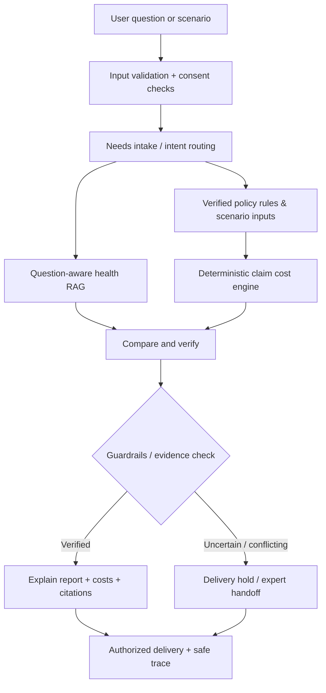

# Assurely: Insurance Transparency, Claim-Cost Intelligence & Exploration Blueprint

**Document type:** Engineering/product specification for an implementation agent  
**Prepared:** 2026-10-26  
**Target:** Existing Assurely health-insurance advisory platform; preserve its current FastAPI / LangGraph / Postgres / Redis / Chroma / Next.js architecture wherever verified  
**Status:** PROPOSED implementation blueprint, **not** a statement that features below have been implemented or production-validated  
**Primary video:** [Mandatory 10% Health Insurance Co-Pay? Know Everything Before You Buy! | By Ankit Sir (Baaten Bazar Ki)](https://www.youtube.com/watch?v=azO6XvUKGiw)  
**Target reader:** AI coding agent + project maintainer

---

## 0. Executive mandate for the implementation agent

Build on the *existing* Assurely project to help users understand **what insurance promises, what it excludes, what they could pay at claim time, which document supports each conclusion, and which decisions still need human verification**.

**Do not start by adding a new agent or rewriting the app.** First inspect the actual repository, docs, migrations, test suites and API contracts. Reconcile this blueprint against the **current** code before making changes. Earlier project reports are historical snapshots, not proof of current status.

Success means a person can:

1. Understand co-pay, deductible, excluded/non-payable items, sub-limits, waiting periods and coverage restrictions in simple language.
2. Explore policy provisions with exact insurer-document evidence and applicable version/effective date.
3. Simulate **estimated** out-of-pocket costs with a transparent itemized breakdown, clearly marked assumptions, and no promise of claim approval.
4. Compare policies by **premium + potential claim-time exposure**, not simply sum insured or unvalidated numerical scores.
5. Inspect how results change under scenario assumptions, while distinguishing verified policy facts from user inputs and hypothetical assumptions.
6. Recognize a *reported regulatory proposal* versus an effective, official rule.
7. Receive a clearly explained uncertainty/hold/human-review path where evidence is missing, contradictory or consequential.
8. Explore adjacent insurance education and lifecycle assistance without getting misleading coverage guarantees.

### Non-negotiables

- **No invention of insurance terms, premiums, hospital prices, eligibility, regulatory status, or calculator constants.**
- **No actual automatic mandatory 10% co-pay for all users**. It is a media-reported proposal as of the research date, **not a verified universal requirement**. Existing policy-specific contractual co-pay may apply.
- All policy-derived values must be attributable to an approved source **with document/version/clause identifiers**.
- All financial calculations must be **deterministic and replayable**, not generated by an LLM as arithmetic.
- On missing policy rules / ambiguous calculation order / conflicting evidence, **do not silently assume zero or the most favorable interpretation**. Show a range if supportable, label uncertainty and escalate where appropriate.
- Never promise an insurer will pay a precise amount: real claims depend on admissibility, underwriting/claims adjudication, policy wording, medical facts and actual hospital bills.
- Respect existing consent/privacy, delivery holds, rate limits, security and audit patterns.
- Keep health insurance the initial domain. Do not implement life insurance, voice, WhatsApp or universal hospital integrations in this workstream by accident.
- Favor additive, backward-compatible migrations and progressive UI/API rollout.

---

## 1. Source integrity: what the video actually supports

### 1.1 Verified video context

The linked video is titled **“Mandatory 10% Health Insurance Co-Pay? Know Everything Before You Buy! | By Ankit Sir”**, published on Baaten Bazar Ki (BBK), approximately 23 minutes long. An earlier YouTube browser pass opened **625 timestamped Hindi caption segments** (about 00:00–22:58). In the current drafting context, however, only the *video description and opening caption excerpt* were available for close reading; **the full 625-segment transcript was not available as text to independently inspect here**. Consequently, do not treat a detailed topic sequence, exact quotation or timestamp beyond the exposed opening as verified. If exact video coverage is needed, retrieve/review the complete transcript separately before asserting it.

**Directly evidenced by video title/description and accessible opening captions:**

- The video opens by discussing an October 2026 news story about a **possible mandatory 10% health insurance co-payment**.
- What a 10% co-payment is, its hospital-bill impact, and an example using a ₹5 lakh admissible claim.
- Who might be affected *if a proposal is implemented*, especially seniors/families.
- Co-payment **versus** deductible.
- Important policy terms to check when buying or renewing.
- Understanding personal **out-of-pocket** claim expenses.

**Do NOT claim the video explicitly covered** room-rent proportionate deduction, restoration rules, portability procedures, claim appeals, DPDP, RAG design or specific software features unless a full transcript review confirms it. Those are **independent product expansions / official-source-derived features** in this blueprint.

Video URL: https://www.youtube.com/watch?v=azO6XvUKGiw

### 1.2 Independently verified domain and regulatory context

Use the following as supporting research, **not** as statements from the video:

1. **IRDAI health-department FAQ** defines co-payment as a specified amount/percentage of **admissible** claim, deductible, sub-limit and exclusion; explains policy-specific availability. [Official IRDAI FAQ](https://irdai.gov.in/health-dept)
2. **IRDAI health insurance regulatory FAQ** clarifies that a co-payment is cost-sharing on admissible claims and does not reduce sum insured; discusses deductibles and other policy rules. [Official IRDAI FAQ](https://irdai.gov.in/faqs-on-health-insurance-regulations)
3. **IRDAI Master Circular on Health Insurance Business, 29 May 2024** and annexures provide a *Customer Information Sheet (CIS)* framework for key coverage, exclusions, sub-limits, deductibles, waiting periods and consumer procedures. The exact current legal obligations and amendments must be rechecked before shipping. [IRDAI circular index](https://irdai.gov.in/circulars) · [Reference PDF mirror](https://www.caalley.com/irdai_mc/Master_Circular_on_Health_Insurance_Business_29052024.pdf)
4. Contemporary press called the proposed **10% co-pay**, with a reported **₹5 lakh per-claim cap** and possible **1 Jan 2027** start, a **proposal, not an approved universal rule**. [Moneycontrol, 8 Oct 2026](https://www.moneycontrol.com/banking/what-a-proposed-10-co-payment-means-for-health-insurers-and-why-it-may-fall-short-article-14047785.html) · [Business Standard, 5 Oct 2026](https://www.business-standard.com/amp/finance/insurance/insurers-10-co-pay-plan-for-retail-health-claims-may-not-get-irdai-nod-126100500945_1.html?isa=yes) · [India Today, 5 Oct 2026](https://www.indiatoday.in/business/story/health-insurance-policyholders-10-percent-hospital-bill-co-payment-report-3009755-2026-10-05)

**Regulatory implementation rule:** Store proposal facts as `PROPOSED` / `REPORTED`, with source, publication date, `last_checked_at`, and `regulatory_effective_at = NULL` unless a confirmed official instrument supports one. Do not apply a reported prospective date to live user policies. Verify official IRDAI publications again at feature release, and display the *as-of* date of the check.

### 1.3 Provenance legend for every feature and claim

- **[VIDEO]** Directly supported by accessible video title/description/opening.
- **[IRDAI]** Derived from regulator FAQs/CIS topics, not from video narration.
- **[NEWS]** Contemporary reporting about a proposal, not proof of an enforceable regulation.
- **[PRODUCT]** Design proposal from our Assurely product analysis, not an existing/video/legally mandated feature.
- **[REPO]** Referenced in historical project status; requires fresh code verification.

Avoid laundering suggestions into facts. Every end-user statement needs similar distinction (`source_kind`, `verification_status`, `last_verified_at`).

---

## 2. Existing Assurely: known integration points, not instructions to rebuild

Earlier user-shared status reports (30 Sep and 9–10 Oct 2026) described the following **historical** implementation. **VERIFY each against the latest repository first**:

| Existing area | Historical location / role | How the proposed work should integrate |
|---|---|---|
| FastAPI API | `backend/app/api/v1/message.py`, sessions/consent endpoints | Add narrowly scoped simulation/explainer routes and typed contracts; retain hold/redaction behavior |
| LangGraph | `backend/app/graph/build_graph.py` | Reuse the existing flow; selectively enrich evidence and comparison state |
| `needs_intake` | `backend/app/graph/nodes/needs_intake.py` | Ask only missing claim-simulation fields when needed; never demand unnecessary health data |
| `intent_router` | `backend/app/graph/nodes/intent_router.py` | Recognize policy explanation / comparison / scenario calculation requests using minimal safe routing changes |
| `health_domain_agent` | `backend/app/graph/nodes/health_domain_agent.py` | Fetch the **user's actual question**, relevant policy/term version; historic fixed-query retrieval defect must be regression tested |
| Retriever + Chroma | `backend/app/rag/retriever.py`, `backend/app/rag/vector_store.py` | Support clause-level retrieval, policy/version filters and grounding |
| `risk_analysis` | `backend/app/graph/nodes/risk_analysis.py` | Keep eligibility/coverage risk heuristics separate from deterministic **claim-cost** simulator |
| `compare_verify` | `backend/app/graph/nodes/compare_verify.py` | Incorporate rule-backed financial exposure, explicit source evidence, and contradictory evidence states |
| `guardrail` | `backend/app/graph/nodes/guardrail.py` | Block unsupported prices, claim certainty, outdated law status and inconsistent arithmetic |
| `explanation_report` | `backend/app/graph/nodes/explanation_report.py` | Render verified claim-cost components and assumptions with citations; do not let LLM recompute amounts |
| `escalate` | `backend/app/graph/nodes/escalate.py` | Existing hold/handoff route for ambiguous terms, inconsistent evidence, suspicious claims |
| `persist_memory` | `backend/app/graph/nodes/persist_memory.py` | Store only permitted profile context; simulation logs should be redacted/minimized |
| Postgres / Alembic | `policy_documents`, `policy_terms`, `decision_trace`, `consent_records` etc. | Add typed structures or metadata via additive migrations after inspecting existing schema |
| Langfuse | Existing node-level trace instrumentation | Add `claim_calculation`, `evidence_validation` spans and safely redacted cost-accuracy metrics |
| Evaluation | `backend/eval/`, RAGAS, starter cases | Add table-driven financial tests and new retrieval/answer-quality eval scenarios |
| Next.js UI | `/comparison`, `/intake`, `/handoff`; `frontend/lib/api-client.ts` | Make interactive features genuinely call the backend; no placeholder policy results |

**Historical blockers to recheck before feature build:** question-agnostic RAG queries, unverified/synthetic policies, 14% inflation/₹15L assumptions, no live production advisor destination, non-durable MemorySaver session checkpoints, frontend placeholders/contracts, incomplete live RAGAS matrix, confidence-calibration gap. These may have changed since reports; do not overwrite recent progress.

### 2.1 Repository reconnaissance: required FIRST task

1. Read `docs/`, `PROGRESS.md`, actual tree, migrations, graph state schema, domain models, endpoint OpenAPI, frontend types and recent Git changes.
2. Produce `Current → Required → Reuse/Modify/Add → Tests → Risk` gap table per feature.
3. Identify existing `policy_terms` fields, source hash/version propagation, insurer/policy UIN metadata, and policy applicability handling; **extend, don't duplicate**.
4. Confirm whether user question reaches RAG retrieval and whether policy scope filtering works; reference Case 04 regression scenario.
5. Check precise rule order used by existing calculator and actual semantics of `risk_analysis`. Do not call it a claim-cost simulator just because it has a `calculator`.
6. Validate API request/response contracts and whether output hold applies on all read paths (including session reload).
7. Establish clean baseline (`pytest`, E2E, RAG eval), record flaky or failing tests with truthful status.
8. Record assumptions requiring insurer/legal/domain review **before coding**; don't fabricate a current source of truth.

---

## 3. Product experience: the user's complete journey

### Journey A: first-time insurance buyer

1. User provides basic needs: individual/family floater, ages, city, intended annual budget and optional coverage goals. Health data is optional, minimized and consent-gated.
2. Assurely asks targeted missing questions, explains why they're needed, and shows **unknown/unverified** instead of guessing.
3. User explores verified candidates and opens a **Coverage Facts / CIS View** for each: coverage, exclusions, waiting periods, co-pay, deductible, sub-limits, cashless/claim process.
4. Comparison shows **premium separately from estimated claim-time out-of-pocket burden**.
5. User opens a *scenario*, e.g., ₹5 lakh admissible hospitalization, alters assumptions and sees itemized explanation.
6. Every material policy claim has linked document/page/clause/version, verification date, and uncertainty warnings.
7. If specific interpretation is unsupported or contradictory, app says why and offers human handoff; never forces a ranking.

### Journey B: user with an existing policy

1. Upload/select policy PDF + CIS; classify and screen document using existing ingestion controls; obtain consent if required.
2. Extract actual terms, identify missing/risky items, allow user to review unverified fields with source snapshots.
3. Generate a **“What you have / What you may pay / What to verify”** dossier.
4. Explore hypothetical claim costs and policy terms; avoid a claims-approval promise.
5. Offer renewal/portability explainer and a review checklist, but do not submit insurance applications or initiate transfer without explicit separate consent/workflow.

### Journey C: parent/senior-citizen cover

1. Consider age-band or policy-specific co-pays, coverage waiting periods, chronic-condition exclusions/restrictions and budget impact **only when verified/applicable**.
2. Show catastrophic-bill scenarios with cash liquidity implications. Do not assume older people always have a particular copay.
3. Distinguish quoted premium, projected renewal premium (if evidence), and hypothetical inflation estimates.
4. Highlight unknown claim rules and need for insurer/advisor confirmation.

### Journey D: hypothetical hospital bill

User selects e.g. ₹5 lakh gross hospital bill with ₹50k non-payable components. Simulator returns:

- Gross bill: ₹5,00,000.
- Non-payable items: ₹50,000.
- Preliminary eligible/admissible amount: ₹4,50,000.
- Illustrative deductible: ₹25,000.
- Illustrative 10% co-pay applied **after deductible** for **this specified hypothetical rule ordering**: ₹42,500.
- Estimated insurer payment: ₹3,82,500.
- Estimated user payment: ₹1,17,500 (₹50k + ₹25k + ₹42.5k).
- `₹3,82,500 + ₹1,17,500 = ₹5,00,000` (ledger reconciliation).

**Do not generalize this order to every real policy.** Any rule-order ambiguity blocks a single definitive quote. Scenario output must show policy-specific rules vs hypothetical inputs.

### Journey E: “What if the reported 10% rule is introduced?”

A clearly labeled **proposal explainer** can compare a hypothetical 10% setting to a verified policy's current terms for educational purposes only. It must not override any current quote or plan. Optional *reported ₹5 lakh cap* is also an explicit hypothetical parameter, not a live legal fact. This experience should be **off by default** in real policy recommendations.

---

## 4. Feature catalogue: precise requirements, dependencies and priorities

Priority legend: **P0** = required for reliable claim-cost MVP; **P1** = meaningful consumer utility; **P2** = later exploration/scale.

### F01 · Verified policy terms and CIS explorer [VIDEO][IRDAI][PRODUCT] — P0

**Why:** People can't understand financial exposure without seeing the contract's terms. The Customer Information Sheet (CIS) is an excellent user-facing index but is not a substitute for full policy wording.

**Inputs:** Official policy wording, CIS, riders/endorsements, chosen plan/variant, age bands, effective dates.

**Behavior:**
- Show policy name, insurer, UIN (if verified), plan variant, sum insured, effective/issue dates, verified source.
- Categorize hospitalisation cover, waiting periods, PED rules, co-pays, deductibles, room rent/ICU limits, package/procedure sub-limits, exclusions, day care, restoration and benefit limits only where verified.
- For each fact render `value`, `applicability`, `source citation`, `version`, `confidence status`, `last verified`, and any conflicting claim.
- Compare CIS summary against full wording; full policy wording/valid endorsements govern details. If sources conflict, flag for human review, not silent preference.
- Support `Not found`, `Ambiguous`, `Not applicable`, `Not verified`, and `Verified` as distinct states.

**Acceptance:** A user can click “Co-pay: 20%” and see the exact contract clause and who/when it applies. No synthetic rate is displayed as verified.

### F02 · Co-payment clause intelligence [VIDEO][IRDAI][PRODUCT] — P0

**Why:** A 10/20/30% co-pay can materially change a claim.

**Data:** percentage or amount, base (`admissible_claim`, treatment-eligible or other per wording), age/insured scope, claim type, policy year, provider/network restrictions, waiver, per-claim cap, special exceptions, effectivity, source evidence.

**Behavior:**
- Explain copay vs total hospital bill: co-pay is generally on admissible/defined amount, not always gross invoice.
- Detect policy-specific triggers, e.g. `age >= specified threshold` **only when stated**.
- Separate base/default co-pay and event/condition-specific overrides. Never blindly sum overlapping percentages.
- Warn about percentages absent in source text, undefined base, or unsupported waiver assumptions.

**Acceptance:** Formula and base visible; applying 10% to an admissible ₹5 lakh claim yields ₹50,000 absent other rules. Current policy results must never default to the media-reported 10% proposal.

### F03 · Deductible and excess intelligence [VIDEO][IRDAI][PRODUCT] — P0

**Why:** A fixed amount may be borne before coverage starts; may be annual, per claim, family aggregate, or product-specific.

**Data:** amount, unit, per-claim/per-policy-year basis, shared family bucket, remaining deductible, applicable expense category and reset date.

**Acceptance:** Repeated claims decrement deductible balance exactly according to verified contract; unknown deductible period produces `needs_verification`, not invented reset behavior.

### F04 · Claim-cost / out-of-pocket simulator [VIDEO][PRODUCT] — P0

**Purpose:** Show an **estimate under declared assumptions**, not a claim settlement quote.

**Inputs:** selected verified policy version, age/beneficiary and applicable riders, gross/itemized bill (or explicit simplified scenario), user-provided non-payables, benefit/category, deductible state, coverage remaining, verified co-pay, source-backed room/package limitations; clearly segregate verified from hypothetical values.

**Outputs:** line-item ledger: bill, excluded/non-payable, eligible basis, contractual adjustments, deductible, co-pay, limit effect, estimated insurer share, estimated user share, explicit `unknown_or_unmodeled` items, rule trace, evidence and warnings.

**Core properties:**
- Only calculate from trusted typed policy terms. LLM never performs arithmetic or asserts the result directly.
- Per-policy **rule application order is explicit and versioned**; unsupported order = range/unknown/handoff.
- Monetary arithmetic uses `Decimal` (no binary floating-point currency), INR paise rounding as configured.
- `gross_bill == insurer_payment + user_payment` for fully classified single-insurer modelled scenarios; any unexplained residual must surface explicitly rather than being silently discarded.
- Insurer payment must never exceed the remaining applicable sum insured / sublimit / eligible benefit base.
- Model exclusions, waiting-period noncoverage, proportionate deduction and other complex clauses only with validated rule interpretation; otherwise refuse precise estimate.
- Prevent double application of co-pay, deductible, room-limit deductions or non-payables.
- Show disclaimer: **“Illustrative estimate. Actual admissibility and settlement are decided under your policy by the insurer.”**

**Examples & tests:** See Sections 6 and 11.

### F05 · Premium versus claim-time exposure comparison [VIDEO][PRODUCT] — P1

- Separate **premium price paid regardless of claim** from **conditional out-of-pocket cost if a claim happens**.
- Show scenario matrix: no claim, low admissible bill, ₹5L, ₹10L, and user-entered bills; never infer a risk probability unless supported by data.
- User can view two or three policies side by side with verified cost components and missing evidence.
- Optional `premium + scenario personal cost` is a *scenario total expense*, not expected annual cost/actuarial value.
- No “cheapest”/“best” assertions where premiums or policy facts are synthetic/unverified; use *compare available facts* instead.
- Show household cash-at-risk and affordability prompt without financial advice guarantees.

**Acceptance:** UI labels assumptions, current quoted vs hypothetical costs, time frame and source/version; no unsupported rankings.

### F06 · Senior / family floater implications explorer [VIDEO][PRODUCT] — P1

- Family-member scenario selector; no inference that a particular age automatically creates a co-pay.
- Member-specific applicable terms; sum insured/remaining family pool; multiple-claim examples.
- Optional high-cost emergency scenario to illustrate **cash reserve exposure**, not predicted illness.
- Support multiple insured members **only** with explicit shared vs individual benefit logic.

### F07 · Policy restrictions / hidden-clause impact explainer [IRDAI][PRODUCT] — P1

- Reuse `compare_verify` hidden-clause capabilities; enrich with financial impact *when actually computable*.
- Plain-language explanation for exclusions, PED waits, disease-specific waits, room-rent caps, procedure limits, co-pay, deductibles, coverage-restoration rules.
- **“Clause → Trigger → Effect on claim → Evidence → Verification status”** presentation.
- Avoid alarmist labels: some restrictions are ordinary contract terms; call them *material restrictions*, not inherently fraudulent clauses.

### F08 · Regulatory-status and policy-version watch [NEWS][PRODUCT] — P1/P2

- Maintain immutable dated items as `REPORTED`, `CONSULTATION`, `PROPOSED`, `APPROVED`, `EFFECTIVE`, `SUPERSEDED`, `WITHDRAWN`, `UNKNOWN`.
- Sources: regulator first, insurer filings/contracts next, mainstream news as secondary reports.
- Human-confirm transitions into `APPROVED`/`EFFECTIVE`; attach official document, instrument ID, applicability, signed date, effective date and known exemptions.
- Display the reported 10% copay **only** as *news/proposal explainer* until officially supported, not live calculation default.
- Version-diff policy documents and compare terms before/after **without** automatically applying an industry news item to all policies.

### F09 · Insurance concepts learning centre [VIDEO][IRDAI][PRODUCT] — P1

- Plain English/Hinglish explanations with concrete examples, term definitions and FAQ cards.
- Topics: co-pay, deductible, sum insured, admissible claim, exclusions, sub-limits, cashless vs reimbursement, waiting periods, restoration, premium, renewal, portability, CIS.
- Interactive mini calculator uses fictitious scenarios and clear labels.
- Link every regulatory assertion to official sources and effective dates.

### F10 · What-to-check-before-buying checklist [VIDEO][IRDAI][PRODUCT] — P1

User-friendly pre-purchase/renewal checklist derived from the CIS, including:
- exact insurer/product/variant and latest wording;
- scope, exclusions, caps, co-pay, deductible, PED and other waiting periods;
- budget: annual premium and possible claim-time cash required;
- network/empanelment status from actual verified current insurer sources, not assumed;
- claim documentation and service channels;
- free-look, renewal, migration/portability, grievance/ombudsman details only as currently applicable;
- disclosure obligations and insurer-confirmation questions.

Export/share as user-owned PDF later if desired; no need to add it to Phase 1.

### F11 · Claim-readiness and discrepancy assistant [IRDAI][PRODUCT] — P2

- Educational process guide for cashless vs reimbursement, receipts, forms and case-specific questions.
- If a real claim statement is uploaded (separate explicit consent), show *potential discrepancies for review*, not a binding denial appeal or insurer adjudication.
- Never imply an insurance claim was filed, approved or appealed unless integrated/confirmed by an authorized insurer process.
- Add privacy/security review for medical bills before enabling uploads.

### F12 · Source contradiction & uncertainty dashboard [PRODUCT] — P0/P1

- Compare same insurer + same product UIN/variant + same benefit + same applicable version/effective period.
- Detect conflicts among CIS, policy wording, riders, brochures and aggregator summaries.
- Prefer not to auto-decide regulatory/legal precedence without reviewed rules; show source hierarchy as a review aid, require confirmation for consequential conflicts.
- Propagate `UNRESOLVED_CONFLICT` and `needs_human_review` through guardrail, API and UI.

### F13 · Consent-aware saved scenarios & side-by-side history [PRODUCT] — P2

- Optional user-owned saved scenarios, manual labels, policy version frozen at time of run, change notifications.
- Retain minimally necessary metadata; deletion and consent withdrawal must be honored.
- Store **what was simulated**, not a claim/diagnosis prediction.

### F14 · Future exploration only: network hospitals, pricing, renewals, claim tracking [PRODUCT] — P2+

- **Hospital-network explorer:** require legitimate timely insurer/provider data; beware stale network status. No invented current network coverage.
- **Actual live premium quotes:** only via approved integrations and regulated distribution arrangements, never LLM-generated prices.
- **Renewal calendar:** user-authored reminders + verified official servicing steps, not automated renewal or policy changes.
- **Claims timeline:** user-uploaded/verified insurer events with receipts and evidence; avoid misrepresenting any API as live.
- **Multilingual:** translate explanations with preserved citations, legal terms and reviewed terminology.

---

## 5. Design principles: policy facts and risk knowledge are not the same

**Separation of concerns:**

- `risk_analysis`: user/risk-profile or coverage adequacy insights; may depend on contextual assumptions and should disclose them.
- `policy_term_extractor`: converts insurer wording into **candidate** typed facts with evidence and uncertainty.
- `policy_term_verifier`: validates candidate facts against exact source/version and applicability, potentially human-reviewed.
- `claim_cost_engine`: pure deterministic arithmetic on **verified/applicable rules plus explicit scenario inputs**.
- `compare_verify`: orchestrates comparison and evidence interpretation; does not fabricate missing financial terms.
- `explanation_report`: explains already-computed ledger/unknowns; should not alter calculated numbers.
- `guardrail`: checks numerical reconciliation, evidence, authorization, regulation status and delivery safety.

**Keep money code pure:** Functional core independent of LLM providers, easy to unit/property-test. The LLM can interpret text or paraphrase final explanations but cannot introduce unvalidated values to the ledger.

---

## 6. Claim-cost engine: auditable computation contract

### 6.1 Required normalized inputs

Suggested typed objects (names flexible after repository inspection):

```text
ClaimScenario
  scenario_id
  selected_policy_version_id
  member_id_or_anonymous_age_band
  gross_bill_inr
  line_items[]  # optional amount, service category, treatment context
  stated_nonpayables[]
  claim_category  # inpatient/daycare/etc.
  admission_date_or_scenario_date
  sum_insured_remaining_inr?       # unknown allowed
  deductible_used_to_date_inr?    # unknown allowed
  source_of_each_input = VERIFIED_TERM | USER_INPUT | HYPOTHETICAL | UNKNOWN

VerifiedPolicyRuleSet
  policy_document_hash
  policy_version / plan_variant / UIN
  rule_version
  rules[] : rule_type, value, unit, basis, priority, applicability,
            source_clause, verification_status, effective_date
  conflict_status

ClaimSimulationResult
  status = COMPLETE | PARTIAL | NEEDS_VERIFICATION | UNSUPPORTED
  currency = INR
  breakdown[]: id, description, amount, rule_id, input_provenance
  insurer_estimate_inr?
  user_estimate_inr?
  unexplained_amount_inr?
  unmodeled_terms[]
  warnings[]
  assumptions[]
  source_evidence[]
  rule_trace[]
  calculation_version
```

### 6.2 Rule pipeline (illustrative; actual order is policy-specific)

1. Verify the policy/version/plan/beneficiary and rule applicability.
2. Classify submitted bill and line items; separate clearly confirmed non-payables/exclusions from *unknown* admissibility.
3. Establish admissible benefit category and verified package/sub-limits; handle room-rent proportional deductions if supported.
4. Apply deductible **as contractually defined** (per claim/year, remaining balance, coverage scope).
5. Apply co-pay on its contractually defined base, with verified cap, override rules and rounding.
6. Bound payable amount by per-benefit limits and sum insured remaining. Restoration and other limits require explicit modeled and verified triggers.
7. Return a **balanced ledger** with uncertainty and full calculation/evidence trace.
8. Reject/refuse a definitive single number where source rules or order are ambiguous; a range is permissible only if both endpoints are computed from justified scenarios and clearly labeled.

**There is no universal formula for every policy.** An engine that always performs `insurer = (bill - nonpayable - deductible) * (1 - copay)` is inadequate for real policies. Support only certified rule templates first and expand with tests and expert validation.

### 6.3 Tiny Python-style pseudocode; DO NOT ship as production algorithm

```python
from decimal import Decimal

def example_after_deductible_copay(gross: Decimal, nonpayable: Decimal,
                                   deductible: Decimal, copay_pct: Decimal):
    assert gross >= 0 and 0 <= nonpayable <= gross
    admissible = gross - nonpayable
    applied_deductible = min(deductible, admissible)
    copay_base = admissible - applied_deductible
    copay_amount = copay_base * copay_pct
    insurer = copay_base - copay_amount
    user = nonpayable + applied_deductible + copay_amount
    assert insurer + user == gross  # after deterministic rounding allocation
    return insurer, user
```

**Never call this universal policy math.** The implementation needs rule definitions, applicability and exact paise-level rounding.

### 6.4 Required illustrative examples

| Example | Conditions | Expected outcome |
|---|---|---|
| A | ₹5,00,000 fully admissible, 10% co-pay, no other deductions | User ₹50,000; insurer ₹4,50,000 |
| B | ₹5,00,000 gross, ₹50,000 non-payable, 10% co-pay on remaining ₹4,50,000, no other reductions | User ₹95,000; insurer ₹4,05,000 |
| C | ₹5,00,000 gross, ₹50,000 non-payable, ₹25,000 deductible, 10% co-pay **after deductible** | User ₹1,17,500; insurer ₹3,82,500 |
| D | ₹5,00,000 gross, full amount excluded by verified clause | No modeled insurer payment; user exposure ₹5,00,000; explain applicable clause |
| E | Policy-specific co-pay unknown | `NEEDS_VERIFICATION`; do not assume 0% or 10% |
| F | 10% reported *proposal* hypothetical on ₹60L admissible claim with reported ₹5L cap | Show `min(₹6L, ₹5L) = ₹5L` only **within labeled hypothetical proposal mode**, never current live quote |

### 6.5 Edge cases to design explicitly

- Two or more co-pay rules that overlap by age/treatment/network; no accidental addition without contract support.
- Percentage/amount cap, minimum payable, policy-year versus per-claim deductible.
- Multiple claims per year, family floater shared balances, sub-limit already partly consumed.
- Complex room-rent proportionate deductions; no simplistic universal hospital math.
- Sum insured exhausted, restoration triggered or not triggered; no optimistic automatic restoration.
- Mixed payable/nonpayable line items and unidentified expenses.
- Age/date boundary conditions, policy renewal changeover and endorsement effective dates.
- Rounding, decimal input, negatives, excessive claims, zero bills, missing values.
- Cashless/reimbursement mode should change *process explanation*, not invent a different financial rule unless contract says so.
- Co-pay does **not automatically reduce sum insured** (consult applicable official definitions); insurer-paid amount and available cover calculation need correct rules.

---

## 7. Data model and provenance design

**Inspect existing SQLAlchemy/Alembic structures first.** Example additive models/fields; names are proposals:

| Proposed data unit | Key attributes | Storage strategy |
|---|---|---|
| `policy_document_versions` (or extend existing) | policy ID, insurer, variant, UIN if known, checksum, effective/issued date, source URL, approval status | Postgres; immutable version records |
| `policy_rule_facts` / extend `policy_terms` | term type, normalized value, unit, contract basis, applicability JSON, source clause/page, extraction confidence, human-review state | Postgres, indexed by policy/version/type |
| `policy_rule_sets` | canonical ruleset version/hash, verified term IDs, execution order, reviewer, approved_at | Immutable versioned Postgres |
| `claim_simulation_runs` | scenario ID, rule-set hash, redacted inputs, calculated ledger, warnings, created_at, engine version | Postgres if explicitly saved; ephemeral otherwise |
| `regulatory_updates` | headline, source, status, regulator artifact, proposed vs effective dates, last_checked, reviewer | Postgres, immutable updates/event history |
| `source_conflicts` | competing source IDs, term identity, discrepancy, state, reviewer resolution | Postgres |
| `feedback_reviews` | user-reported issue, trace link, evidence, validated status, regression case | Later milestone |

### Fact and evidence contract

Each policy-derived value must have at least:

```json
{
  "policy_version_id": "policy-version-123",
  "term_type": "copayment",
  "normalized_value": "0.20",
  "value_unit": "fraction",
  "applies_to": {"claim_category": "inpatient"},
  "basis": "admissible_amount_as_defined",
  "source": {
    "document_hash": "sha256:...",
    "document_kind": "policy_wording",
    "page": 17,
    "clause": "4.2"
  },
  "verification_status": "VERIFIED",
  "verified_at": "2026-10-26T00:00:00Z"
}
```

**Sample shape, not a claim about existing data.** Do not reuse these illustrative values or date as factual policy metadata. Field naming should match codebase conventions.

Source precedence is not universal. E.g. endorsements can modify main wording; a summary/CIS can omit detail; an aggregator may be stale. Record *conflict and applicability* and have reviewed resolver behavior.

### Data governance

- Store document SHA-256 and stable `source_ref` for traceability.
- Don't overwrite approved facts after re-ingestion; create version records and diff.
- Do not expose private document URLs, internal IDs or PII through public comparison pages.
- Guard private simulations and sessions with auth/consent/ownership; support deletion rules and audit where lawful.
- Secure file ingestion with existing PDF validation, malware/injection screening and quarantine.
- Redact health data from Langfuse generation traces and exception logs.

---

## 8. APIs and graph state contracts

**Do not hard-code these endpoint names if existing equivalent routes already exist.** Finalize based on OpenAPI and code review.

### Suggested API surface

```text
GET  /v1/policies/{policy_id}/facts?version=...
GET  /v1/policies/{policy_id}/sources?version=...
POST /v1/claim-simulations
GET  /v1/claim-simulations/{simulation_id}      # only if saving/authenticated
POST /v1/policy-comparisons/scenarios
GET  /v1/insurance-glossary/{term}
GET  /v1/regulatory-updates?status=...
```

`POST /v1/claim-simulations` requirements:
- Pydantic validated request: numeric ranges, currency INR, supported scenario categories, policy version ID, source of each user input.
- Authentication and rate limiting per existing security model; anonymous *generic examples* may be public without PII.
- Return `status`, itemized ledger, policy/source links, assumptions, warnings, unknowns, rule-set hash; **no guaranteed payout**.
- Proper 4xx for invalid input, 409/422 for incompatible/contradictory terms where appropriate, and safe 5xx for internal failure.
- Never return a successful `COMPLETE` status with empty/unverified cost terms.
- Keep older `/v1/message` contract stable. Frontend integrations should reuse a typed API client, not parse arbitrary LLM prose.

### Graph integration option (minimal first)

**Option A recommended:** Keep claim simulator as a **deterministic service** invoked by existing `compare_verify` / API route when user intent requires it. No new LangGraph node initially.

`intent_router` should categorize simulation/explainer intents or attach a sub-intent, while retaining existing health vs life routing.



If a separate graph node is justified after production metrics, document why; otherwise avoid agent proliferation.

**Question-aware retrieval is a prerequisite.** A previous Case 04 found that fixed topic queries ignored the actual waiting-period question. Never evaluate claim clauses using irrelevant background chunks. Preserve policy/version filters and query-evidence logging.

---

## 9. Frontend IA and user experience specification

### Page 1: `/comparison` enrich existing page

- Cards/tables with coverage, restrictions, verified premium or `Unavailable`, potential user liability, and citations.
- Clear separation between `Known contractual term`, `User input`, `Simulation assumption`, `Unavailable`, `Reported proposal`.
- Side-by-side claim scenarios and policy term differences.
- Click any financial item to reveal **How we calculated it** and corresponding clause.
- Visible per-policy verified-on date. No static fake backend data marketed as real.

### Page 2: `Claim Cost Explorer` (route determined from existing IA)

Inputs: bill amount, choose claim category, optionally add nonpayable line items, select policy/version, deductible balance when known.

Outputs:

```text
Gross hospital bill            ₹5,00,000
Non-admissible charges           ₹50,000
Eligible base                   ₹4,50,000
Deductible (example only)         ₹25,000
Co-pay (example only)             ₹42,500
Estimated insurer payment       ₹3,82,500
Estimated amount you pay        ₹1,17,500
```

- Show horizontal stacked visualization: insurer vs customer with unknowns separately.
- Collapsible item explanations, citations and assumptions.
- Slider/input for *hypothetical* copay percentage only in **Learn / What-if** mode, not in verified policy mode.
- Accessibility: keyboard support, screen-reader labels, color-independent information, currency formats, mobile layout.
- Do not show “Guaranteed payout”, “Claim will be approved”, or misleading accuracy percentage.

### Page 3: Policy Facts / CIS Explorer

- Sections: Basics, Who/what is covered, Important exclusions, Waiting periods, Cost sharing, Limits, Claims process, References.
- Evidence viewer with page/clause and effective date. Unverified facts have distinct visual treatment.
- User prompt templates: “What does this co-pay apply to?”, “Are there disease-specific restrictions?”, “What happens if I choose a higher room category?”

### Page 4: Learn / Explore

- Beginner-friendly glossary, what-if lessons and illustrative examples.
- Reported 10% proposal as dated explainer only. Banner: `NOT AN EFFECTIVE UNIVERSAL RULE` until reverified as official.
- Videos can be linked as educational media but should **not** become contract evidence.

### Page 5: Handoff / Verification queue

- Explain *which exact term* could not be verified and what evidence is needed.
- Preserve delivery hold across refresh/history endpoints.
- Avoid leaking hidden report data in client props/cache or API response bodies.

---

## 10. Safety, compliance and UX guardrails

1. **Evidence gating:** No financial contract assertion without verified policy wording or approved structured facts; unknown is a valid result.
2. **Regulatory gating:** Proposed 2027 dates or 10% co-pay cannot auto-apply to active contracts.
3. **Arithmetic invariants:** Nonnegative amounts, ledger reconciliation, no insurer overpayment beyond modeled applicable limits.
4. **Missing-order gating:** If multiple deductions could apply in ambiguous sequence, mark `NEEDS_VERIFICATION`, not arbitrary order.
5. **Disclosure:** No claim-approval guarantee, no fictional premium, no blanket “best policy” when key terms unverified.
6. **Privacy:** Minimum required scenario data, encryption/access control, retention, consent, safe logging. Follow current applicable Indian data-protection framework; get legal review before real personal/health data processing.
7. **Prompt injection:** Imported policy text is untrusted; enforce current ingestion screening and use quoted retrieval context, not executable instructions.
8. **Escalation:** Route unresolved material claims/contradictions to existing human-review mechanism, with delivery hold and explicit status.
9. **Snapshot integrity:** Saved comparison frozen to term version and engine version; disclose if an updated document makes prior output stale.
10. **Output parity:** Financial ledger must match API and UI numbers to the paisa. Never let LLM edit numerical results.
11. **Recommendation scope:** Educational comparison does not automatically authorize insurance solicitation/acting as a licensed intermediary. Have counsel review regulated activities, compensation, disclosures, product marketing and user consent before launch.
12. **Law source hierarchy:** IRDAI primary sources and actual official insurer policy wording govern appropriate claims; secondary news is informational only.

---

## 11. Testing, Evals and acceptance matrix

### 11.1 Deterministic unit tests (must be green)

- C01: ₹5L admissible and 10% co-pay -> ₹50k user / ₹4.5L insurer, under the known simplified rules.
- C02: ₹5L gross; ₹50k nonpayable; 10% of ₹4.5L -> ₹95k user / ₹4.05L insurer.
- C03: ₹5L gross; ₹50k nonpayable; ₹25k deductible; 10% after deductible -> ₹117.5k user / ₹382.5k insurer.
- C04: Unknown co-pay/ambiguous order -> explicitly `NEEDS_VERIFICATION`, not 0%, not an invented 10%.
- C05: Sum insured and sub-limit cap applied to appropriate insurer-payable base without overdrawing.
- C06: Co-pay cap and deductible reset frequency only activate when verified contract rules exist.
- C07: Two policy-specific co-pay rules don't stack without documented applicability.
- C08: Unknown age band or missing plan variant doesn't select an optimistic rule.
- C09: Multiple family floater claims preserve shared balances correctly.
- C10: Negative numbers, huge values, zero bill, out-of-range percentages and malformed decimals rejected.
- C11: Paise rounding and ledger invariants pass property-based fuzz testing.
- C12: Same inputs + policy rule/version hash + engine version => same deterministic result.
- C13: Proposal news record never changes a verified policy simulation in default mode.

### 11.2 Evidence/retrieval/E2E tests

- E01: User asks PED waiting period while `pre_existing_conditions=False`; retrieval still obtains actual waiting-period clause (historical Case 04 regression).
- E02: Exact policy/variant/version filters prevent retrieving another insurer's clause.
- E03: CIS and wording conflict flags an unresolved issue and prevents definitive payout claim.
- E04: Changes to approved policy wording create a new version, not silent overwrite.
- E05: Invalid PDF, hidden prompt instructions, malicious embedded payload -> screening/quarantine.
- E06: API authorization/consent prevents cross-user scenario reads.
- E07: Hold result cannot be exposed through refresh, sessions, cache or UI navigation.
- E08: Report LLM token truncation -> explicit failure status or safe retry; no empty JSON interpreted as success (historical Case 05).
- E09: Frontend `intake → select policy → simulate → compare → source view → uncertainty/handoff` uses real API and passes Playwright tests.
- E10: Mobile, screen reader, color contrast, error and loading states.

### 11.3 AI-evaluation improvements

Expand RAGAS and custom rubrics with labeled cases:
- policy co-pay extraction with base and applicability;
- deductible scope/time period;
- senior-citizen condition applies vs doesn't apply;
- contradictory sources by version;
- question-aware retrieval for specific clauses;
- reported regulatory proposal vs binding rule;
- no invented prices or guarantees;
- a case requiring legitimate uncertainty/handoff.

Rubric dimensions: grounding, exact numerical/term reproduction, rule applicability, uncertainty disclosure, citation granularity, explanation clarity, safe escalation. **Hard-fail** factual errors on contract terms regardless of average rubric score.

Maintain confidence calibration separately: rubric score is not a calibrated probability. No `90% confidence` to users until a validated target/label methodology and held-out dataset support it.

### 11.4 Release gates

All gates required before promoting from synthetic/internal demo to real customer policies:

- [ ] Verified official policy wordings/CIS with documented versions and expert-approved extraction.
- [ ] No active unverified calculator assumptions in final outputs.
- [ ] Correct retrieval, contradiction and report-generation regression cases pass.
- [ ] Numeric ledgers pass deterministic/property tests.
- [ ] Full evaluation suite and representative rubric cases recorded with reproducible artifacts.
- [ ] Auth provider, consent flows, safe storage, access and retention verified.
- [ ] Human destination and delivery holds tested, including failed delivery/refresh.
- [ ] Session continuity across restart/multiple workers validated.
- [ ] Regulatory/legal review completed for data protection, product claims and distribution activities.
- [ ] Real browser end-to-end and production-like load/backup/restore checks pass.

---

## 12. Milestones / proposed work breakdown

Do not claim a calendar estimate until repository review and available engineering capacity are known. Build in the following dependency order.

### M0 · Repository alignment and evidence inventory (first)

**Tasks:** inspect current docs, schema/graph/frontend, reconcile past bug status, identify source-of-truth insurer data, check IRDAI revisions.  
**Deliverables:** current-state gap map; source inventory; API/schema plan; updated acceptance criteria.  
**Exit:** every planned modification has a real owning file/module; no duplicate subsystem designed.

### M1 · Contract truth & reliable retrieval (highest priority)

**Tasks:** question-aware retrieval; source/version filters; verified normalized co-pay/deductible/sub-limit facts; contradiction status; provenance propagation; test fixture coverage.  
**Exit:** a policy clause can be traced to official document/version and invalid/missing terms fail safe.

### M2 · Claim-cost deterministic engine

**Tasks:** configurable rule templates, ledger, paise handling, scenario engine, known/unknown/unsupported states, rule trace, unit/property tests.  
**Exit:** Example A/B/C and tricky deductibles/overrides match independently reviewed fixtures.

### M3 · Safe API and frontend launchable flow

**Tasks:** typed endpoints; auth/consent/rate limits; source-linked policy explorer; claim simulator; comparison cards; hold/error/empty states; real API client.  
**Exit:** end-to-end browser flow works with *verified demo policies* and no fake quote data.

### M4 · Eval, security and operations hardening

**Tasks:** complete RAGAS matrix, rubric score, report truncation handling, Langfuse redaction, permission and persistence tests, advisor handoff, deployment and privacy/legal review.  
**Exit:** explicit launch gates in Section 11 passed, reviewer sign-offs captured.

### M5 · Rich exploration (after correct MVP)

**Tasks:** senior/family scenarios, interactive glossary, renewal/buying checklist, proposal watch, saved scenarios/feedback loop.  
**Exit:** each feature has evidence and source-of-truth, meaningful analytics, regression tests and responsible UX copy.

### M6 · Partner integrations (not in this sprint)

**Tasks:** real insurer quote/network/claims integrations only with legitimate API access, permissions, commercial and regulatory review.  
**Exit:** live integrations prove freshness/accuracy; no scraped or guessed real-time claims.

---

## 13. Suggested code layout (NOT prescriptive; adapt actual tree)

```text
backend/app/
  domain/claim_cost/
    schemas.py              # input/output contracts and states
    rule_types.py           # typed applicability and pricing rules
    engine.py               # deterministic cost ledger
    validators.py           # invariants and contract checks
    rule_trace.py           # explainable step-by-step audit
  services/
    policy_rule_service.py  # existing policy_terms -> verified rule set
    source_verifier.py      # document/version/clause provenance
    simulation_service.py   # policy rules + scenario -> engine
    regulatory_status.py    # proposed vs effective dated records
  api/v1/
    ...                     # extend existing routers rather than duplicating
  graph/nodes/
    compare_verify.py       # invokes service, no new money math inside LLM
    explanation_report.py   # faithfully explains returned ledger
    guardrail.py            # evidence, amount, uncertainty gates

backend/tests/
  unit/test_claim_cost_engine.py
  unit/test_claim_cost_rule_order.py
  integration/test_simulation_api.py
  integration/test_hold_redaction.py
  eval/...                   # policy-term eval cases, rubrics

frontend/
  ...                       # reuse existing component, route, API-client conventions
  components/insurance/
    ClaimCostBreakdown.*
    PolicyFactsExplorer.*
    PolicyFinancialComparison.*
    EvidenceCitation.*
```

Avoid creating these files blindly. Use existing module patterns, ownership, naming and migration strategy.

---

## 14. Agent implementation instructions / coding guardrails

When this file is pointed to an implementation agent, execute this workflow:

1. **Inspect, do not assume** repository state; summarize present behavior with exact file locations, versions and gaps.
2. Draft a short **dependency-aware implementation plan** mapped to feature IDs F01–F14 and milestones M0–M6; prioritize M0/M1/M2.
3. Do not touch unrelated working flows; write failing tests for each current behavior gap first.
4. Reuse FastAPI, current ORM/migration tooling, Chroma, LangGraph, Redis, Langfuse and Next.js components. Do not add multiple redundant new agents, vector DBs or message queues.
5. Implement typed **verified** policy terms and deterministic money rules before exposing simulation outputs in UI.
6. Keep current synthetic seeded policy data explicitly `SYNTHETIC / NOT FOR REAL ADVICE`; do not represent it as issued insurer contract wording.
7. Fix question-aware RAG and provenance before claiming the AI knows a clause.
8. Add cross-layer tests for API, persistence, frontend, consent and delivery hold. Avoid client-side-only safety.
9. Before each substantial change, run backend regression and the relevant RAG eval; compare result artifacts and failures honestly.
10. Update `PROGRESS.md` and architecture docs with completed vs partially verified status. Mention any domain-expert/regulatory verification still needed.
11. Preserve transparent finance UX: every output indicates **source**, **date/version**, **assumptions**, **unknowns**, **calculations** and **why**.
12. Never state `done` for a feature that is merely designed, unit-tested but not live-verified, or implemented behind unconfigured integrations.

### Required output at the end of each implementation milestone

```text
Milestone / Feature IDs:
Files created or changed:
Existing components reused:
Behavior implemented (verified facts):
Unit / integration / E2E / eval commands and results:
Unverified assumptions / dependencies:
Before/after screenshots or example JSON, if applicable:
Remaining blockers:
PROGRESS.md / architecture doc updates:
```

---

## 15. Product differentiation and scope control

**Core value proposition:**

> **Assurely helps people understand what insurance covers, discover material restrictions, compare verified policy terms and estimate what they could still pay when a claim happens, with the source and assumptions visible for every important conclusion.**

**Why this is better than a generic chatbot:** It is a versioned evidence and deterministic computation workflow, not an LLM generating unsupported policy recommendations. It explicitly permits “we don't know yet” and offers review.

**Why this should not become a bloated platform immediately:** Reliable factual extraction, claim-cost math and live user flow are the critical differentiators. Network-hospital directories, insurance purchasing, multilingual voice agents and actual claims handling should wait until trustworthy sources and integrations exist.

### “Must not do” list

- Do **not** implement mandatory universal 10% co-pay as if passed into law.
- Do **not** hardcode 14% medical inflation, ₹15L adequacy threshold or sample premiums as authoritative universal rules.
- Do **not** use one fixed deduction order for every insurer.
- Do **not** mix gross bill with admissible claim amount.
- Do **not** calculate co-pay on non-covered items unless actual contract supports it.
- Do **not** silently treat missing terms as zeros.
- Do **not** save identifiable medical scenarios without legal/consent checks.
- Do **not** confuse a valid-looking JSON answer with truthful, evidence-grounded coverage.
- Do **not** rank policies by unsupported “AI confidence”, made-up claim probabilities or invented quotes.
- Do **not** claim any feature is working end to end while frontend continues to use placeholder API responses.
- Do **not** call research/news a regulatory fact without official verification.

---

## 16. Final handoff checklist (copy into project tracker)

| ID | Capability | Priority | Dependency | Done means |
|---|---|---|---|---|
| F01 | Verified policy/CIS facts | P0 | M0 + source inventory | Source-linked terms and variant applicability |
| F02 | Co-pay intelligence | P0 | F01 | Correct contract-defined base and scope |
| F03 | Deductible intelligence | P0 | F01 | Per claim/year/family semantics tested |
| F04 | Out-of-pocket simulator | P0 | F02+F03 | Itemized reconciled deterministic ledger |
| F12 | Conflict/uncertainty | P0 | F01 | Unsupported terms block definitive calculations |
| F05 | Financial comparison | P1 | F04 | Scenario-based premium vs exposure UI |
| F06 | Senior/family explorer | P1 | F01+F04 | Member-specific verified rules |
| F07 | Restriction impact explainer | P1 | F01+F04 | Clause → cost effect → citation |
| F09 | Insurance learning centre | P1 | Verified glossary | Factual educational examples |
| F10 | Pre-buy checklist | P1 | F01 | User-readable official-topic checklist |
| F08 | Regulatory watch | P1/P2 | Official review process | Correct proposed/approved/effective states |
| F11 | Claim readiness | P2 | Consent/security | Educational guide, no claim guarantee |
| F13 | Saved simulations | P2 | Auth/persistence | Safe consent-aware frozen snapshots |
| F14 | Partner integrations | P2+ | Contracts + compliance | Legitimate fresh external data |

## 17. Source references and verification notes

**Source date:** researched for 26 October 2026. Public rules, insurer forms and proposal status may change; confirm at point of release.

- [YouTube video: Ankit Sir / Baaten Bazar Ki](https://www.youtube.com/watch?v=azO6XvUKGiw) (video description + available opening captions support the attributed topics; full transcript should be separately re-reviewed before a quote/timestamp-level documentary claim).
- [IRDAI: Health Department FAQ](https://irdai.gov.in/health-dept) (official insurance glossary, coverage terms and products).
- [IRDAI: FAQs on Health Insurance Regulations](https://irdai.gov.in/faqs-on-health-insurance-regulations) (official co-pay/deductible and policyholder explanations).
- [IRDAI: Circulars index](https://irdai.gov.in/circulars) (official source for checking current master circulars and new regulatory notices).
- [IRDAI Master Circular on Health Insurance Business (29 May 2024; reference PDF mirror)](https://www.caalley.com/irdai_mc/Master_Circular_on_Health_Insurance_Business_29052024.pdf) (CIS fields and coverage/claim topics; verify current superseding instruments).
- [Moneycontrol, 8 Oct 2026: proposed 10% co-pay is not final](https://www.moneycontrol.com/banking/what-a-proposed-10-co-payment-means-for-health-insurers-and-why-it-may-fall-short-article-14047785.html).
- [Business Standard, 5 Oct 2026: industry proposal may not get regulator nod](https://www.business-standard.com/amp/finance/insurance/insurers-10-co-pay-plan-for-retail-health-claims-may-not-get-irdai-nod-126100500945_1.html?isa=yes).
- [India Today, 5 Oct 2026: reported mechanics and contingent date](https://www.indiatoday.in/business/story/health-insurance-policyholders-10-percent-hospital-bill-co-payment-report-3009755-2026-10-05).

**Not legal, actuarial or individualized insurance advice.** Obtain appropriate legal, domain and insurer-source review before handling real recommendations, quotes, medical data, regulated distribution, or claims.
