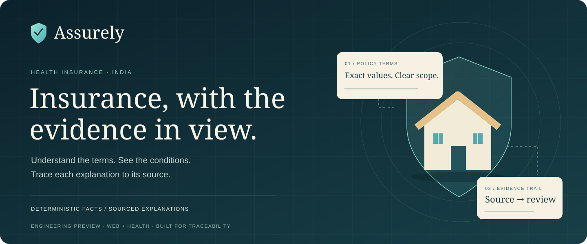
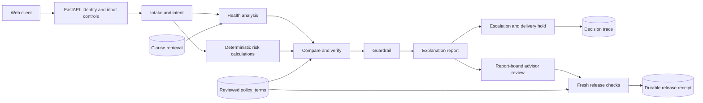

<p align="center">
  
</p>

<p align="center">
  <strong>Understand your cover. Inspect the evidence. Know what still needs review.</strong><br />
  An India-focused health insurance transparency platform built with Next.js, FastAPI and LangGraph.
</p>

<p align="center">
  <a href="#quick-start">Quick start</a> ·
  <a href="#architecture">Architecture</a> ·
  <a href="#project-status">Status</a> ·
  <a href="#development--testing">Testing</a> ·
  <a href="CONTRIBUTING.md">Contributing</a>
</p>

---

Assurely connects deterministic policy facts, source-linked explanations and human
review. It compares policies against stated needs and keeps uncertain or
unapproved reports behind a delivery hold. The banner is original project artwork,
not a product screenshot.

## Why Assurely

- **Facts with a defined source.** Policy values come from structured `policy_terms`;
  retrieval supplies clause wording, not invented numbers.
- **Conditions stay visible.** Reviewed reports preserve discrete cover values,
  calendar units, policy identity, applicability and conditional scope.
- **An inspectable trail.** Source pages, document hashes, review dates and
  publication events remain attached to report evidence.
- **Independent controls.** Input screening, guardrail checks, advisor review and
  fresh release checks each enforce their own boundary.
- **Generation is separate from delivery.** An advisor can inspect a generated
  report while customer delivery remains held. Queue acknowledgment is not approval.

## Project status

**Active development · Phase 1 · Web chat + health insurance.** This is an
engineering preview, not a production-approved advisory service.

| Area | Implemented | Remaining boundary |
| --- | --- | --- |
| Frontend | Landing, intake/comparison previews, light/dark UI | Backend integration and complete journey verification |
| Advisory graph | Intake, health/risk analysis, comparison, guardrail, report, escalation, decision trace | Production validation and durable full-graph recovery |
| Policy review | PDF evidence, typed rules, publication/revocation, reviewed terms | Qualified insurer/tariff/calculator approval |
| Advisor workflow | Verified identity, exact-report approval, expiry and revocation | Live operator configuration |
| Release | Durable turn/report binding and transactional release receipts | Production comparison guardrail remains held; migration/deployment review pending |
| Evaluation | Unit/integration suites and recorded experiments | Semantic verifier calibration is not production-approved |

Seeded policy terms and calculator assumptions are **unverified scaffolding**.
Medical-inflation and tertiary-care sizing assumptions need qualified review.
Confidence is a completeness/compliance heuristic, not a calibrated probability.
Extracted source material is not automatically approved. Read
[PROGRESS.md](PROGRESS.md) and [the release order](docs/backend-release-order.md)
for dated results, deviations and priorities.

Life insurance, WhatsApp, voice, multilingual expansion and the blueprint's
claim-cost simulator are outside the current implemented scope.

## Quick start

Requirements: Git, Docker with Linux containers and Compose, plus Node.js/npm
compatible with the frontend's Next.js version. The backend image uses Python
3.11; dependencies are declared in [pyproject.toml](backend/pyproject.toml).

### Backend

From the repository root, copy the credential-free example **only if `.env`
does not already exist**, then start the local stack:

```sh
cp backend/.env.example backend/.env
docker compose up -d --build
docker compose exec api alembic upgrade head
```

| Service | Local address |
| --- | --- |
| API health | http://localhost:8000/health |
| Interactive API docs | http://localhost:8000/docs |
| Postgres | `localhost:5432` |
| Redis | `localhost:6379` |
| Chroma | `localhost:8100` |

Compose binds services to loopback and uses development credentials. It explicitly
sets `ENVIRONMENT=development`; changing `.env` alone does not override that value.
This is a local development stack, not a deployment recipe.

Optional synthetic policy demo:

```sh
docker compose exec api python -m app.db.seed
```

Seeding does not publish reviewed facts. Immutable audit migrations can refuse
destructive downgrade after data exists. Review migration contracts before
operating on persistent data. Live model-backed chat needs provider credentials;
mocked deterministic tests do not.

### Frontend

In another terminal:

```sh
cd frontend
npm ci
npm run dev
```

Open http://localhost:3000. Starting both servers does not establish a completed
backend-connected customer journey; several frontend views remain previews.

## Architecture



This shows the health path; incomplete intake and out-of-scope branches can exit
early. Graph edges use deterministic state checks. Only `explanation_report` writes
generated output, and it runs even when escalation is required. Release receipts
record transaction-time decisions, not proof of network delivery.

| Layer | Technology |
| --- | --- |
| Web | Next.js App Router, React, TypeScript, Tailwind CSS |
| API/workflow | FastAPI, Pydantic, LangGraph |
| Durable records | PostgreSQL, SQLAlchemy async, Alembic |
| Supporting services | Redis, Chroma |
| Models/observability | Configurable provider fallback, Langfuse integration |

## Configuration and API

[`.env.example`](backend/.env.example) lists local settings. Protected APIs require
`AUTH_ISSUER`, `AUTH_AUDIENCE` and `AUTH_JWKS_URL` for a trusted RS256 identity
provider. Reviewer, publisher and advisor allowlists are independent and empty by
default. Client-supplied roles cannot grant access. Keep real credentials in ignored
local configuration; never paste them into issues or commits.

| API group | Purpose |
| --- | --- |
| `POST /v1/message` | Conversation turn with delivery redaction |
| `GET /v1/session/{id}` | Ownership-checked session view |
| `/v1/policy-reviews` | Evidence staging and representation review |
| `/v1/policy-publications` | Publication/revocation and reviewed term import |
| `/v1/advisor-reviews` | Exact-report snapshot, approval and revocation |
| `GET /v1/sessions/{id}/report-status` | Owner-only durable report metadata |
| `POST /v1/sessions/{id}/report-release` | Owner-only fresh release decision |

Use `/docs` on the running API for request schemas. The release endpoint cannot
bypass guardrail disapproval; the production comparison gate remains held. Read
[release semantics and recovery limits](docs/report-release.md).

## Development & testing

Read [AGENTS.md](AGENTS.md) and [PROGRESS.md](PROGRESS.md) before making changes.
Build a dedicated image and run unit checks without external network access:

```sh
docker build -t assurely-api:local ./backend
docker run --rm --network none assurely-api:local python -m pytest tests/unit -q
docker run --rm --network none assurely-api:local ruff check app tests
```

Rebuild that image after changes. Integration tests need explicitly isolated
Postgres storage; several reset their test schema. Never use application storage.
See [isolated release verification](docs/report-release.md#verification).

Frontend checks:

```sh
cd frontend
npm run lint
npm run build
```

A passing build is not visual QA. Inspect running pages on desktop/mobile and in
both themes. Test counts in the progress log are dated checkpoint results, not a
claim that every current repository check passes.

## Repository map

```text
backend/
  app/api/          HTTP boundaries and access control
  app/graph/        Nodes, report helpers and evidence checks
  app/db/           Policy, advisor and release workflows
  app/models/       Durable records
  alembic/          Versioned migrations
  tests/            Unit and isolated Postgres tests
  eval/             Evaluation cases and experiments
frontend/           Next.js application and assets
docs/               Architecture, contracts and review notes
scripts/            Development and capture helpers
PROGRESS.md         Dated checkpoints and remaining work
```

## Roadmap and documentation

1. Review the production guardrail/report contract and finish full-graph recovery.
2. Complete qualified policy/tariff/calculator approval and live auth/advisor setup.
3. Connect the frontend and verify the complete customer/advisor journey.
4. Scope additional blueprint capabilities separately from the health/web MVP.

[Master roadmap](docs/insurance-platform-master-roadmap.md) ·
[Architecture](docs/insurance-platform-tech-stack-hld-lld.md) ·
[Evaluation harness](docs/insurance-platform-eval-harness.md) ·
[Reviewed reports](docs/reviewed-explanation-report.md) ·
[Blueprint assessment](docs/blueprint-scope-assessment-20261028.md)

## Contributing, security and license

See [CONTRIBUTING.md](CONTRIBUTING.md) for workflow and review expectations and
[SECURITY.md](SECURITY.md) for sensitive findings. Use synthetic fixtures; do not
commit customer information, credentials, raw policy PDFs or private traces.

**License status:** no software license is currently included. Public source
availability does not itself grant open-source reuse rights. A maintainer-selected
license is needed before presenting this as a licensed open-source release.
Third-party dependencies and assets retain their own licenses.
