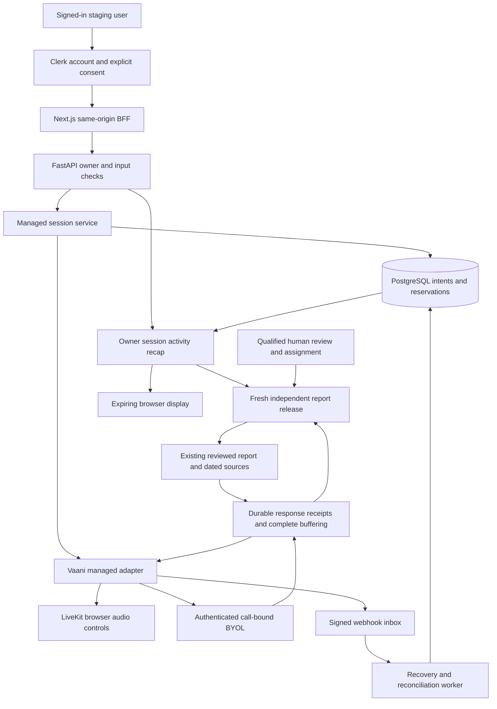

# Vaani voice architecture and activity recap checkpoint

Date: 2026-11-14. Parent orchestrated a backend developer, test engineer and
independent architecture/security reviewer. This checkpoint implements activity
recaps, strengthens saved excerpts and closes account-change privacy gaps.
It does not certify the entire product as complete or ready for customer calls.

## Connected architecture

These arrows describe code connections, not proof that an actual Vaani call ran.
Customer calls and paid billing remain disabled. Existing default-off staging
flags still control provider, binding, tools and report speech. No migration,
production deployment, remote configuration or provider request was performed.
No new graph node, routing decision, insurance report writer or knowledge base
was introduced.

## Implemented in this checkpoint

### Session activity recap

`GET /v1/voice/development/sessions/{session_id}/activity-recap` returns an
owner-scoped, no-store projection of existing migration 017 response receipts.
It performs no provider dispatch, usage settlement or new content persistence.

The exact response has:

- `kind=voice_session_activity_recap`, session ID/state and generation/display dates.
- `transcript_stored=false`, `audio_delivery_verified=false`.
- At most 128 events, each with response ID, normalized intent, answer kind,
  status and existing timestamps. Raw questions, report content hashes and
  credentials are not projected as event text.
- `report_availability=available|not_sent|unavailable` and nullable
  `reviewed_report`, containing the exact frozen binding/report identity and
  freshly authorized complete sentences with dated source references.

Internal `report` intent is projected as `report_read`. Pending/prepared responses
stay pending, `send_unknown` stays delivery uncertain, and `sent` means only that
the backend socket send returned. A received or played answer is never inferred.
Unsupported requests are recorded as an unsupported operation, without a fabricated
question or answer summary.

An active or ended synthetic session can be inspected. Staging/Clerk/test access,
current local identity, current processing consent and separate current
`voice_summary` consent remain mandatory. Historical access does not require
opening a microphone or restoring audio permission. Existing entitlement-first
locks cover session, consent, receipts and fresh release in one transaction.

Report text is included only if a sent factual receipt matches the exact frozen
binding and source digest and current independent release succeeds. A newer hold,
changed report, advisor decision or withdrawn source prevents text projection;
safe event metadata can still be returned. Display permission is at most ten
seconds and cannot outlive current source/human approval expiry.

The private frontend offers explicit permission load/grant/withdraw and recap
view/hide controls. A closed runtime decoder checks identity, sequence, status,
timestamps, evidence and leases. Periodic GET refresh clears prior text before
checking again. Blur, hidden/offline state, expiry, failures and unmount clear
displayed content; return requires fresh authorization. The panel makes no claim
that the recap reconstructs the natural conversation or proves audible delivery.

### Saved report excerpt controls

The existing saved-excerpt service now authorizes identity, current processing and
summary consent, report release and read/write within one entitlement-serialized
transaction. It uses actual independent `report_release.release()` authority
rather than the older graph-delivery helper. Reviewed reports no longer depend on
the legacy helper's inability to release `reviewed_report_held` content.

Compatibility is intentionally narrower: these APIs now require reviewed staging
case access. A synthetic `ready` graph result is not independent human release.
Deleted or expired idempotency-key retries return unavailable and cannot recreate
optional content. Read authority expires within ten seconds and source/review/
retention expiry. Request keys and deletion metadata remain preserved.

Withdrawing `voice_summary` clears owned optional excerpt ciphertext inside the
consent transaction. A rapid regrant cannot restore content waiting for worker
purge. Existing minimal response/usage receipts remain for integrity and auditing;
derived activity is again accessible only after a new valid summary grant.
Deletion of already exported content or vendor recordings is not claimed.

### Account and asynchronous media isolation

The entire voice workspace/controller is now keyed by Clerk account, with
account-specific recovery and uncertain-start storage keys. Old global recovery
keys are not silently assigned to an account. Existing server reservations still
prevent replacing an active call with a new call.

A workspace lifetime aborts outstanding reads/writes on cleanup. Every awaited
microphone/consent/start/connect/end stage checks that lifetime before continuing.
If the browser permission dialog resolves after account exit, all returned probe
tracks are closed and consent/dispatch cannot proceed from that old action.
An in-flight mutation may already have committed server-side; abort is not rollback.
Retry keys remain stable and server recovery remains responsible for uncertainty.

### Truthful release inventory

The existing release-status API now reports configuration booleans, an implementation
inventory, and a separate `runtime_observations` section. Schema, worker and provider
authentication remain `not_checked` there. The actual `/ready` probe remains the
runtime health path; the separate worker retains its own health receipt.

Even with every static configuration check satisfied, status is
`awaiting_external_acceptance`. It never grants paid/customer release or transforms
an operator configuration flag into captured provider evidence. Secret values,
agent configuration, URLs with credentials and customer data are not returned.

## Files changed

- New backend: `backend/app/voice/activity.py`,
  `backend/app/api/v1/voice_activity.py`; router registration.
- Backend hardening: `backend/app/voice/recaps.py`,
  `backend/app/api/v1/consent.py`, `backend/app/voice/release.py`.
- New frontend: `frontend/components/product/VoiceActivityRecap.tsx`,
  `frontend/lib/voice/activity.ts`, `activity-display.ts`, `workspace-lifetime.ts`.
- Frontend integration: `VoiceDevelopment.tsx`, `lib/voice/api.ts`, shared
  `case-contracts.ts`, the BFF GET allowlist and `package.json` test command.
- New tests: backend unit/integration `test_voice_activity.py`, unit
  `test_voice_release_inventory.py`, frontend `voice-activity.test.cjs` and
  `voice-workspace.test.cjs`.
- Existing test maintenance: reviewed-authorization fixture in
  `test_voice_next.py`; short IDs for six unchanged large-input test cases in
  `test_byol_evidence_bridge.py` to avoid the Windows environment-size limit.
- Paired specifications, root implementation report and PROGRESS updated.

## Verification performed

| Check | Actual result |
|---|---|
| Affected backend voice/auth/review regression | **215 passed**, zero failures/errors/skips |
| New activity/consent units | **16 passed**, included in 215 |
| Release inventory units | **8 passed**, included in 215 |
| Frontend contract/SDK checks | **30 passed** |
| Frontend voice development/case/activity/account checks | **32 passed** |
| Frontend media controller mocks | **14 passed** |
| Next.js production build / TypeScript / changed ESLint | Passed |
| Changed Python Ruff | Passed |
| Targeted strict mypy | Passed for five modules with the local Python 3.14 target |
| New real PostgreSQL suite | **25 collected; not executed** |
| Full backend unit collection | Blocked by installed local Chroma dependency's dotenv behavior under the offline policy |

Receipts: `artifacts/voice-activity-regression-final-20261114.xml`,
`voice-activity-unit-20261114.xml`, `voice-activity-frontend-20261114.xml`,
`voice-release-inventory-unit-20261114.xml`. Focused runs overlap the regression
receipt and are not added as extra distinct coverage. Frontend total is 76.

Docker Desktop was started hidden, but its Linux Engine remained unavailable with
HTTP 500. No test containers, databases or volumes could be created. The authored
PostgreSQL suite covers real release fixtures, consent/deletion races, ended
sessions, integrity, stable usage and concurrency; collection is not pass evidence.
No forced WSL shutdown, Docker reset, application migration or compose operation
was performed. Python 3.11 Docker validation remains blocked; local mypy required
3.14 because an installed NumPy stub uses newer syntax. Do not interpret this as
certification of the deployed Python runtime.

The security reviewer reported no unresolved concrete finding in the implemented
deltas. Langfuse privacy guidance was consulted without adding raw report/transcript
telemetry, changing SDK pins or mutating a remote project. Create UI and installed
Next.js guides were used. No actual browser/device/audio acceptance is inferred
from TypeScript, unit tests or the production build.

## What remains and the required order

1. Restore a healthy Docker Linux Engine and execute the new PostgreSQL suite and
   relevant Linux runtime regressions. Review migration deployment/backup before
   applying candidates to staging. This checkpoint adds no migration.
2. Recheck the owned Vaani development agent, current HTTPS/WSS origin and exact
   BYOL/signing configuration. Capture genuine call/room binding, no-fallback,
   signed terminal duration and durable reconciliation evidence using fictional
   data. Never reuse an old Quick Tunnel URL without checking it.
3. Verify actual microphone/audio, disclosure/source speech, interruption,
   reconnect, consent withdrawal and provider hard termination. Customer calls
   and paid subscriptions stay disabled through those checks.
4. Build unrestricted natural spoken follow-ups and a true consented conversation
   summary with explicit human-release/evidence contracts. Current four-command
   report reading and receipt-derived activity do not satisfy those capabilities.
   Approved claim-expense calculator scenarios also remain unimplemented.
5. Complete reviewed merchant pricing/cancellation/refund workflows, operator
   notification/intake UI, vendor retention/deletion and actual human/device/
   language/accessibility/operational acceptance. These require real contracts
   and responsible human decisions, not generated approvals.

Core transport/lifecycle/report-reading architecture is implemented locally, but
the full natural-conversation product and its release acceptance remain incomplete.
No claim of a completed live Vaani journey or production readiness is made.
