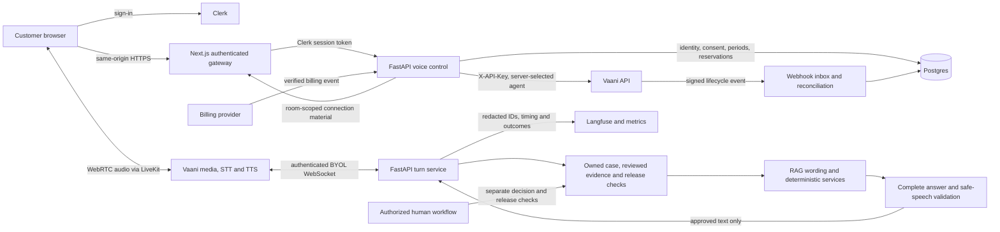
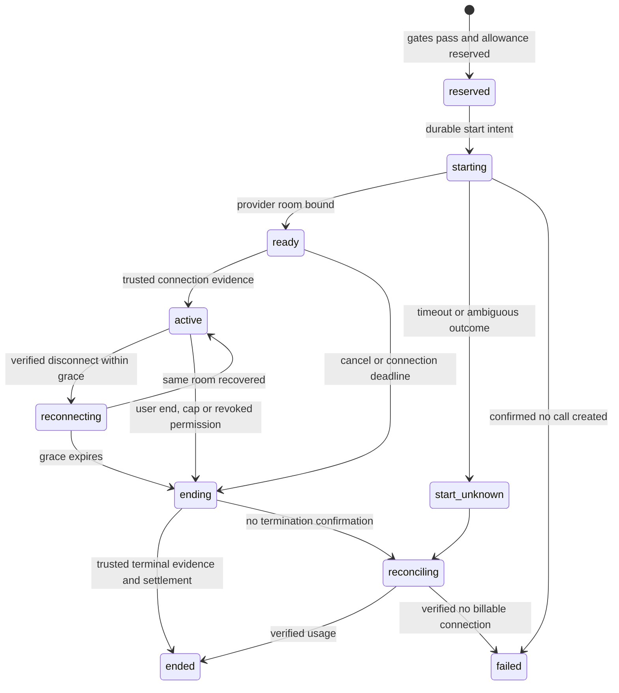

# Technical spec: Assurely AI Voice Insurance Guide

**2026-11-14 implementation contract:** reuse migration 017 response receipts for
GET-only activity recaps, bounded to 128 events. No new table or graph routing is
required. Identity, processing/summary consent, receipt reads and optional exact
report projection share an entitlement-first transaction. Only a matching sent
report receipt permits a fresh report-release attempt; unknown sends cannot be
claimed heard. Display authority expires within ten seconds and current source/
review expiry. Existing saved excerpt creation/read/delete must serialize with
revocation and current human release. The frontend keys the complete media workspace
and recovery storage by account, aborts stale work, and hides recap text on expiry,
blur or account change. Release inventory distinguishes configured software from
unobserved runtime and pending external acceptance; it never manufactures approval.

**2026-11-09 guarded BYOL checkpoint:** additive candidate migration
`017_voice_byol_turns` records immutable normalized response intent and one-shot
send fences without storing report/transcript text. Complete buffering, repeated
existing report-release checks, explicit current report-export consent and a
committed non-replayable `send_unknown` precede bounded socket I/O. A separate
receiver fences obsolete work before any renewal await. No send/disconnect event
settles voice usage. `VOICE_BYOL_EVIDENCE_ENABLED=false` preserves fixed-response
BYOL by default; application migration/activation and genuine provider acceptance
are still pending. Purpose `voice_report_speech` uses its dedicated version
`voice-report-speech-2026-11-09`; old purpose versions are unchanged. Detailed lock
order, state transitions, limits, tests and deviations:
[guarded bridge implementation](VOICE_BYOL_EVIDENCE_IMPLEMENTATION.md).

**2026-11-09 reviewed-text checkpoint:** candidate migration
`016_voice_case_binding` binds one owned synthetic voice session to the exact
server-selected report turn/digest and original human release receipt. All binding
and caption reads call existing transactional release checks; projection never
rewrites graph output or grants future approval. Text has a maximum ten-second
presentation lease, rechecked browser authorization and explicit no-live-transcript /
no-external-speech flags. Application activation is unchanged. Full contract:
[case binding implementation](VOICE_CASE_BINDING_IMPLEMENTATION.md).

**2026-11-08 human-review checkpoint:** additive candidate migration
`015_human_review_requests` and Clerk owner request/status endpoints are implemented.
Request-key and owner-budget advisory locks precede the existing case-head lock and
escalation row lock. Immutable receipts use database `clock_timestamp()` and preserve
assignment and advisor decision records. Report release checks the latest request
against the actual authorized advisor decision on every retry, independently of the
creation flag. The operator intake API projects only bounded identifiers/statuses.
No graph edge, report writer, provider tool dispatch or actual notification changes.
See [contracts, tests and limits](VOICE_HUMAN_REVIEW_IMPLEMENTATION.md).

**2026-11-08 implementation update:** managed lifecycle APIs/worker, mounted private LiveKit
development UI, current-report/follow-up evidence tools, consented encrypted report excerpts,
signed test billing and gated test-period spending/rollover are implemented. Customer calls
and paid billing remain disabled. This does not close live-provider or all V3?V5 acceptance.
The earlier 401/invalid-agent and unmounted-control statements are historical; account reads
passed on November 7. See [the phase implementation checkpoint](VAANI_PHASES_IMPLEMENTATION_20261108.md)
for exact completed work, tests, deviations and remaining software/approval gates.


**Operational follow-up:** Docker and application schema 013 are verified locally after backup;
temporary public HTTPS ingress/signature checks pass, while authorized BYOL 101 remains gated.
Separate recovery and synthetic deadline markers preserve reservations. LiveKit browser controls
are prepared/unmounted. [Current report](VAANI_DOCKER_TUNNEL_REPORT.md) distinguishes these
results from actual provider, termination, media and billing acceptance.

**V2a implementation addendum, 2026-11-07:** the HTTP adapter, signed event inbox/worker,
synthetic-only authenticated BYOL endpoint and additive migration 013 now exist. Live
acceptance remains blocked by HTTP 401, no valid agent UUID and no verified staging host.
See [V2a implementation/traceability](VAANI_V2A_IMPLEMENTATION_REPORT.md) and
[dashboard configuration](VAANI_V2A_SETUP.md). Earlier planned/unimplemented statements below
are the November 6 baseline where explicitly superseded by this addendum.

**Document:** TS-VOICE-001 · **Version:** 1.2 · **Date:** 2026-11-07\
**Status:** V1 and V2a backend code tested; development ingress verified; actual provider/BYOL/audio acceptance and V2b-V5 release gates remain open.
**Companion:** [Functional spec FS-VOICE-001](VAANI_VOICE_FUNCTIONAL_SPEC.md). Requirement/acceptance IDs refer to that file.

## 1. Stack and repository audit

| Layer | Existing implementation | Planned voice responsibility |
|---|---|---|
| Browser application | Next.js 16 App Router, TypeScript, Create UI; `frontend/components/product/VoiceDemo.tsx` and private `/voice-demo` | Consent, audio controls, status, captions/evidence, usage and recap |
| Identity | Clerk frontend; independent FastAPI SDK/JWT checks in `backend/app/core/security.py` and existing identity mapping | Verified Clerk subject maps to internal user UUID; no browser-supplied customer/role authority |
| Same-origin gateway | `frontend/app/api/backend/[...path]/route.ts` | Restricted authenticated API forwarding; no Vaani master API key in browser |
| Application backend | FastAPI/Python; `backend/app/api/v1/voice.py` | Session, entitlement, consent, authorization, provider orchestration and owner-scoped reads |
| Persistence | PostgreSQL/SQLAlchemy/Alembic; migration `011_voice_entitlements`, `012_voice_lifecycle`, `013_vaani_backend` | Durable reservations, usage, provider bindings and later billing-period/event reconciliation |
| Advisory engine | Existing LangGraph, reviewed comparison/delivery, source publication, guardrails and report-release workflows | Reuse controlled evidence and deterministic services without altering graph routing |
| Calculators | `backend/app/calculators/health_cover_sizing.py`, risk/HLV helpers | Expose only verified capabilities; existing cover-sizing assumptions are development-only and are not a complete claim settlement engine |
| Provider abstraction | `backend/app/voice/providers.py`: `VoiceProvider`, `MockVoiceProvider` | Add bounded Vaani adapter after contract/package checks |
| Realtime media | None integrated | Browser LiveKit client connects to Vaani's documented WebRTC infrastructure |
| Billing | No live checkout/provider adapter | Provider-neutral contract; candidate Razorpay pending merchant/account verification |
| Tracing | `backend/app/observability/tracing.py`; production constraints pin Langfuse 4.16.0 | Redacted voice/turn/tool traces and operational metrics; usage authority remains Postgres |

**Local configuration (2026-11-07):** the configured `VAANI_API_KEY` returned HTTP 401 during read-only authentication checks. The agent value is not a valid UUID. Distinct strong BYOL/webhook development credentials are stored privately; all new enablement flags remain false. No call was dispatched and no secret value was printed.

### V1 closure and remaining limits

- The current provider is no-network/no-audio. Its fixed `/turn` prompts cannot establish real speech, policy grounding or calculator acceptance.
- Mock start now requires separate `voice_demo` consent for synthetic session/usage metadata. Revocation closes pending/active demos transactionally. Audio/processing flags remain false; live consent enforcement is still V2 work.
- Current entitlement has one row per user and mock settlement uses elapsed server time. It cannot safely model paid period rollover with outstanding reservations or provider billing.
- Mock expiry/recovery now runs independently from durable deadlines, both in the API lifespan and through `python -m app.voice.recovery [--once]`. It never proves real provider termination; no live-call watchdog exists.
- `VoiceSessionService` now enforces entitlement -> ordered sessions -> receipts/ledger locking. Real PostgreSQL parallel start/end/recovery and lock-wait tests validate this mock lifecycle.
- Migration 012 scopes keys by user/operation and stores normalized digests, preserves prior receipts, and adds immutable ledger/history and deferred balance/ownership checks. It does not modify 011.
- V2a now implements `VaaniVoiceProvider`, signed voice events and a synthetic-only BYOL endpoint behind closed flags. Paid billing, recap storage, evidence tools, browser media and provider hard termination remain unimplemented/unverified. Per-phase FR/AC status is in [the implementation report](../VOICE_IMPLEMENTATION_REPORT.md).

The V1 schema change was flagged before implementing migration 012 and was tested only in disposable databases. Graph routing is unchanged. Before a later schema/routing edit, flag the concrete change as required by `AGENTS.md`; preserve applied migrations and historical records.

## 2. Design decisions: what, why, where and how

| Decision | Why | Where/how | Evidence status |
|---|---|---|---|
| WebRTC for browser audio | Supports continuous two-way audio and interruption without telephone dialing. HTTPS REST alone does not provide browser media transport. | Browser LiveKit client sends/receives audio to/from Vaani media infrastructure. FastAPI creates authorized calls and owns business controls. | Vendor documents LiveKit; Assurely media connection not tested |
| Keep Python/FastAPI as authority | Matches existing identity, database, calculator and review architecture; avoids duplicate business rules in JavaScript or vendor prompts. | Next gateway forwards Clerk session; FastAPI independently verifies it before state changes. | Existing architecture |
| Separate media and control paths | Audio bandwidth/codec handling belongs to WebRTC; authorization, evidence and billing require durable server decisions. | Audio bypasses the Next gateway; authenticated session control uses gateway/FastAPI. | Proposed integration |
| Vaani BYOL for real-policy speech | A vendor LLM with optional tools can speak unsupported content before Assurely checks it. Routing each answer through our backend permits validation before TTS. | Authenticated Vaani-to-FastAPI WebSocket, server-selected persona, scoped evidence and final safe-speech validation. | Public protocol documented; account/live behavior unverified |
| Do not stream unchecked tokens | Once spoken, a bad sentence cannot be withdrawn by checking captions afterward. | Buffer and validate a complete bounded answer; stream only the approved response. Fixed safe acknowledgements may be separate from insurance facts. | Required design |
| Postgres reservation/settlement | Prevents double spend, survives restarts, creates auditable adjustments. | Short DB transactions, consistent row locks, unique operation references, durable reconciliation worker. | Mock foundation exists; paid lifecycle pending |
| Server-generated entitlement | Browser payment/status flags are untrusted. | Signed billing events and explicit test allowlists only. | Mock exists; billing pending |
| No automatic provider failover | A fallback LLM would bypass Assurely evidence and output checks. | Configure BYOL fallback `none`; on outage give fixed safe status or terminate. Verify actual deployed agent configuration. | Account setup required |

### Connection diagram

Solid labels describe intended paths, not completed integrations.



WebRTC audio does not pass through our REST API. Vaani still processes speech, and BYOL may forward a conversation history to Assurely. This requires real processing/retention consent and a vendor agreement; changing the LLM path does not remove the vendor privacy boundary.

## 3. Current Vaani contracts and discrepancies

Re-fetched on 2026-11-06. The browser fetch tool could not retrieve these pages; direct HTTPS fetches with `Accept: text/markdown` returned HTTP 200. `docs.vaani.dev/llms.txt` points to markdown pages on `docs.vaanivoice.ai`. Public documentation is not proof that this account is provisioned or that a response is live-verified.

| Area | Contract used by this spec | Verification still required |
|---|---|---|
| API base/auth | `https://api.vaanivoice.ai`, server-side `X-API-Key` | Key validity, workspace permissions and allowed agent |
| Agent management | User-provided `POST /api/create-agent` and modular `/api/agents/{agent_id}/...` configuration paths | Do not auto-create/change a shared production agent; inspect an owned development agent first |
| Direct dispatch | `POST /api/trigger-call/` with `agent_id` and `medium: webrtc` | Real synthetic call, room binding and controllable termination |
| Direct response | Current reference example uses `token`, `room_name`, `connection_url`, optional `live_captions_url`; it does not use the supplied guide's `access_token`/`room_url` names | Pin observed schema; do not blindly accept arbitrary aliases or browser-selected endpoints |
| Languages | Direct request documents `primary_language`, `secondary_language` and optional welcome/voice fields | Exact deployed voices, recognition and code-switch quality |
| Python package | Official docs describe `VaaniClient` and `AsyncVaaniClient`; PyPI currently reports `vaani-sdk==0.3.1` | Inspect package source, dependency compatibility and actual methods before installation/pinning; not installed in this task |
| Managed SDK sessions | Docs separately describe `sessions.create`, `connect`, `get`, `disconnect`; returned `session_token` exchanges for `lk_url`/`lk_token` | Separate lifecycle from direct dispatch; never pass a direct media JWT as a managed-session token |
| BYOL | One authenticated WebSocket per call; response ID ties each answer to its turn | Workspace entitlement, room binding, interruption cancellation, no-fallback configuration |
| Webhook signatures | HMAC-SHA256 of raw body via `X-Webhook-Signature`; lifecycle uses bare hex, postprocessing uses `sha256=` prefix when a secret is configured | Signed real deliveries, secret provisioning/rotation and WebRTC coverage |
| Duration | Current webhook guide explicitly documents **seconds for both** `call_ended` and `call_postprocessing` | Confirm observed account payloads. This supersedes the previous milliseconds note in historical research and blueprint text |
| Event delivery | Lifecycle retries documented; postprocessing may arrive once or never | Durable receipt, reordered/duplicate handling and safe missing-event reconciliation |
| Call details | `GET /api/call-details/{call_id}` may initiate postprocessing; `202` means pending | Do not treat as a harmless status poll when analysis/retention consent is absent |

**Endpoint policy:** use the user's documented Vaani paths and current official contracts. Any `/v1/...` path below is an Assurely-owned proposed API, not a newly invented Vaani endpoint. No outbound telephony or campaign endpoint is part of this feature.

### Direct-dispatch request and response mapping

Server-owned minimal request for the V2 synthetic spike:

```json
{
  "agent_id": "<configured-owned-development-agent>",
  "medium": "webrtc",
  "primary_language": "en",
  "secondary_language": "en",
  "welcome_message": "I am an AI insurance guide. This call uses a fictional example.",
  "metadata": {"assurely_voice_reference": "<opaque-session-reference>"}
}
```

Use the fixed server base URL and key. Browser cannot submit `modify_agent`, an API URL, agent ID, arbitrary metadata or a persona. Any allowed runtime overrides are generated from a versioned server configuration.

Validate a successful response into a provider DTO: room identifier, media token, connection URL and optional captions URL. Require approved TLS/WSS hosts and paths, bounded field lengths and no URL user-info; the trusted token/captions URL remains a secret. Never log it, persist it in browser storage, or return it from ordinary history reads. Return connection credentials only through a dedicated owner-authenticated, no-store response. Unknown fields cannot grant capabilities.

**Lifecycle decision:** V2 begins with direct dispatch because it matches the supplied integration guide. Before paid release, prove a documented server-side hard end/max-duration control for that dispatch. If it cannot meet FR10/FR22, select the documented managed-session lifecycle after verifying its exact SDK/HTTP contract and equivalent safety/consent configuration. Do not infer that `sessions.disconnect` can terminate a direct-dispatch token. No guessed provider termination path is allowed.

## 4. Application flows

### 4.1 Start and connect

1. Browser signs in through Clerk and reads entitlement/case capability status through the same-origin gateway.
2. Show AI disclosure and current consent purposes; request browser microphone permission through a user action. Check device readiness before dispatch and retain tracks only as needed. If server eligibility fails, immediately release local media tracks.
3. Send a bounded start request with language, selected owned case reference and a stable idempotency key. Case binding is a **planned** extension: current mock start rejects it.
4. FastAPI verifies identity and ownership, current consent, applicable evidence/release status, provider availability, current subscription period, budget, call cap and concurrency.
5. Under a short transaction, lock entitlement then period then session in a consistent order. Reserve seconds and create `reserved` session plus durable start intent; commit before network I/O.
6. Call Vaani outside the DB transaction with a timeout and server-selected configuration. Record result, provider room and binding in a second transaction. A provider timeout is ambiguous, not proof of failure: mark `start_unknown`; do not automatically redispatch or release allowance.
7. Owner receives validated, minimal short-lived connection material. Browser joins the same room via LiveKit. Playback/autoplay restrictions expose a clear “Enable audio” action.
8. Mark `active` only from trusted provider/connection evidence. Browser state is advisory. Independently enforce provider duration cap plus server watchdog/reconciliation.

### 4.2 Each insurance turn

1. Authenticate the provider BYOL connection; verify room/session binding and current consent. Browser Clerk tokens are not the provider's service credential.
2. Validate a bounded user utterance and request envelope. Treat vendor transcript, system-role content, metadata and cited documents as untrusted inputs; use Assurely's versioned persona and server-bound context.
3. Recheck current case ownership, holds, source applicability and available capability. Route by explicit deterministic code to read-only evidence/calculator services; an LLM cannot choose a graph transition or approve delivery.
4. Retrieve wording through the existing authorized RAG path. Numeric/eligibility/premium/exclusion facts use applicable reviewed structured terms; no vendor policy corpus duplicate.
5. Generate a bounded explanation from authorized facts, preserve conditions, and validate every claim/citation/date, numeric authority and language policy before sending text to TTS. Unknown support or conflicting evidence produces a fixed refusal/status plus actual review option.
6. Recheck delivery immediately before release. Only validated text and authorized citation IDs are emitted. Captions reflect allowed speech but are not the enforcement mechanism.
7. On interruption/new response ID, cancel obsolete work and discard queued obsolete audio/text according to verified provider behavior. If this cannot be demonstrated, real-case voice remains disabled.

Do not mutate existing graph `output` from the voice service. `explanation_report` remains its sole writer and `guardrail` only approves. A new utterance requiring fresh intake/advisory state uses the existing deterministic workflow and a separately authorized turn; it cannot silently rewrite a released comparison inside a voice explanation.

### 4.3 End, reconnect and recap

End sends an idempotent stop request, halts browser media, requests verified provider termination, and marks `ending` until termination is confirmed. Browser disappearance is not billable-duration evidence. Reload queries the owned session and obtains renewed connection material only if server state, consent, entitlement and the same room permit recovery. A reload never resubmits a fresh dispatch automatically.

Terminal events settle measured customer usage and release unused reserve exactly once. Missing/ambiguous events stay `reconciling`, block unsafe extra starts, and enter bounded operator reconciliation. Optional recap generation uses only permitted conversation material and approved facts; reads recheck current access/hold. Vaani's raw post-call summary is untrusted and is not automatically stored or delivered.

### 4.4 Human review and holds

Reuse `backend/app/api/v1/advisor_reviews.py`, existing escalation assignment, and `backend/app/api/v1/report_release.py` authorization. Source-policy approval, case review and AI voice guidance remain different permissions. The customer-scoped `request_human_review` command can create/reuse a request, never call an operator decision endpoint. A provider transfer event can record connection progress only. No paywall on the existing review request path.

## 5. API contracts

All new browser operations go through the authenticated Next gateway and independent backend authorization. Unknown JSON fields fail validation. Owner IDs, subscription state, minutes, agent/persona and provider URL are server-derived.

| Assurely method/path | Current status | Intended contract |
|---|---|---|
| `GET /v1/voice/entitlement` | Mock implemented | Capability/readiness, plan, period, available/reserved seconds, limits and explicit disabled reason |
| `POST /v1/voice/sessions` | Mock implemented | Current body: `language`, UUID `idempotency_key`; planned: owned `case_session_id`, supported language, stable key and current consent reference; return session status, not a persistent master credential |
| `GET /v1/voice/active` | Mock implemented | Owner's active/pending session or null; no connection secrets |
| `GET /v1/voice/sessions/{id}` | Mock implemented | Owner-scoped state/usage and permitted artifact availability |
| `POST /v1/voice/sessions/{id}/turn` | Mock only | Fixed `copay/estimate/agent_claim/human_review` prompts; never a public arbitrary policy-agent endpoint |
| `POST /v1/voice/sessions/{id}/end` | Mock implemented | Empty body remains valid; optional UUID `idempotency_key` scopes an end operation. Live termination remains gated |
| `POST /v1/voice/sessions/{id}/connection` | Proposed | Refreshable owner-authenticated room credential; recheck all gates; no-store and no duplicate dispatch |
| `GET /v1/voice/sessions/{id}/summary` | Proposed | Consent/access-checked recap with citation references; omit unavailable or held content |
| `POST /v1/webhooks/vaani` | Proposed | Raw-body signed provider ingress; not Clerk-authenticated or browser-accessible through generic proxy |
| `WS /v1/voice/provider/byol/{provider_call_id}` | Proposed | Service-authenticated, size/time-bounded per-call turn channel; no arbitrary case selection |
| `POST /v1/billing/checkout` | Proposed | Server-selected allowlisted plan/return URLs; returns test checkout material until release gates close |
| `POST /v1/webhooks/billing-provider` | Proposed | Provider-specific signature/replay validation; sole external billing transition ingress |

Existing `POST /v1/consent` and `GET /v1/me/consents` remain the consent APIs. Current consent body contains matching `user_id`, purpose, action and the purpose version; server checks matching authenticated identity. Do not describe it as sign-in consent or silently change the current contract.

Responses distinguish `401` identity, `403` permission/required consent, `404` absent or not-owned resource, `402` unavailable entitlement, `409` concurrency/idempotency/state conflict, `422` invalid input, `429` rate limit and `503` provider unavailable. Client messages must not disclose secrets or another customer's resource existence.

## 6. Provider adapter, BYOL and tools

### Module responsibilities

| Path | Status and responsibility |
|---|---|
| `backend/app/voice/providers.py` | Existing protocol/mock; extend explicit capabilities and validated DTOs |
| `backend/app/voice/vaani.py` | Proposed server HTTP/SDK adapter; timeouts, contract normalization, safe errors, status/end capabilities |
| `backend/app/voice/service.py` | Implemented mock `VoiceSessionService`; identity, consent, consistent locks, durable start intent, reservation/end/recovery |
| `backend/app/voice/turns.py` | Proposed safe turn orchestrator and per-turn cancellation |
| `backend/app/voice/tools.py` | Proposed scoped evidence/calculator adapters; reuse reviewed stores and authorization |
| `backend/app/voice/events.py` | Proposed raw-body HMAC verification, normalized lifecycle events, durable inbox |
| `backend/app/voice/recovery.py` | Implemented mock durable-deadline recovery worker/CLI; real provider reconciliation remains proposed |
| `backend/app/billing/` | Proposed provider-neutral billing adapter, signed event transitions and period changes |
| `frontend/components/product/VoiceDemo.tsx` | Existing synthetic-only screen; keep labels truthful |
| `frontend/components/product/VoiceGuide.tsx` | Proposed real call controls and evidence view; reuse Create UI |

Use `AsyncVaaniClient` if the inspected pinned package faithfully implements required contracts and dependency constraints; otherwise a small async `httpx` adapter may call the same documented endpoints. Do not block FastAPI's event loop with a synchronous SDK. Proposed start timeout: 5s connect/20s total, no automatic non-idempotent POST retry. These are application budgets, not vendor guarantees.

### BYOL protocol boundary

The documented provider connects to the configured WebSocket base with the call identifier appended. Configure a dedicated Bearer service secret and validate it before upgrade; never use unauthenticated mode. Bind the call to a server-created session; unknown/racing room IDs remain blocked until correlation is proven. Optional `X-Agent-Id` is supplementary routing metadata, not identity proof.

After acceptance, send the documented readiness frames in order. Validate `response_required` messages and correlate every response with its `response_id`; use `content_complete` only when the approved answer is finished. Keep source claims out of readiness/greeting frames. `end_call` is documented on the final response but is not by itself proof that a silent/failed call can be forcibly terminated. Verify interruption cancellation, room correlation, and fallback `none` on the actual account before real-policy release.

### Internal tool contracts

| Tool | Authoritative input/data | Permissions/output |
|---|---|---|
| `get_verified_policy_clause` | Bound case + approved policy/version + topic | Applicable structured facts plus wording, authorized citation/date; no caller-selected owner |
| `explain_comparison` | Owned released comparison snapshot and current release check | Need-fit differences and preserved conditions; no regeneration of held report |
| `simulate_claim_cost` | Supported scenario schema + reviewed numeric terms | Deterministic result, formula/version, assumptions, supported scope or explicit unavailable status |
| `get_evidence_metadata` | Authorized citation ID | Document/version/clause/date and permitted source link; no arbitrary URL fetch |
| `request_human_review` | Owned case + stable request key; no client-supplied reason or authority | Persisted review request reference/status; never an approval; browser workflow implemented, provider tool wiring pending |

Tool output includes `status`, `case_reference`, `source_version`, `citation_ids`, `last_verified`, `assumptions_status`, `delivery_allowed` and bounded `safe_for_speech` facts. A citation ID alone is insufficient: source applicability, access and claim support must pass. Timestamps for synthetic fixtures are not a qualified verification.

**Calculator boundary:** audit found health-cover sizing with explicitly unverified development assumptions; it is not a general bill adjudicator. Do not wire fictional demo arithmetic or cover sizing as claim-cost simulation. If the scenario needs co-pay/deductible/sub-limit sequencing absent from current deterministic services, define its separate reviewed numeric contract and tests first; keep that capability unavailable until implemented and approved. Do not construct deduction order from an LLM.

## 7. Data model and deterministic state

### Existing migration 011

| Table | Present fields/responsibility | Limits |
|---|---|---|
| `voice_entitlements` | Unique user UUID, provider/subscription ID, plan/status, period dates, included/reserved/consumed seconds and limits | One current row/user; not a historical period ledger |
| `voice_sessions` | Owner, optional case reference, provider call/room, state/language, idempotency key, reservation/consumption, consent snapshot, source mode, trace/error/timestamps | No durable live start intent, connected time, exact provider measurement or recap model |
| `voice_usage_ledger` | Entitlement/session FKs, reservation/settlement/release, seconds, unique operation references, optional source event ID | Does not itself authenticate events or prevent every inconsistent balance |

### Proposed additive schema review, before implementation

The V1 subset (durable mock intent/deadlines/digests, scoped operation receipts and integrity checks) is implemented in migration 012. The following live-provider, artifact and paid-period extensions remain future schema work; do not recreate the V1 receipt mechanism.

- Retain a current entitlement/subscription pointer; add immutable subscription-period rows with allowance, used/reserved balance and effective dates. Sessions and usage bind to the period that funded them.
- Add durable provider start intent, normalized request hash, provider/call binding, connected/end timestamps, reconciliation status, measured duration precision, configuration revision and safe artifact references to sessions.
- Add a durable minimized event inbox with provider, event type, room, signed event timestamp, payload digest and processing status. Avoid storing raw transcripts/recording URLs from the webhook. Store verification metadata needed for audit without storing its secret.
- Add billing subscription/event records, period history and idempotent adjustments; refund/cancellation is a transition, never deletion of usage history.
- Add optional encrypted/minimized recap storage with owner/session, evidence references, consent version, expiry/deletion status. No raw audio table by default.
- Review FK/delete behavior against existing users and ledger `RESTRICT` constraints before promising account deletion. Use pseudonymization/retention where required rather than accidental cascade loss of financial audit.
- DB constraints: nonnegative amounts; ordered dates; unique provider-call and settlement operations; included >= consumed + reserved unless an explicit reviewed adjustment policy applies. Billing overrun goes to operator loss accounting, not an automatic customer overage.

New migration numbers follow actual repository head at implementation time. Never edit already-applied 011 to add later behavior.

### State transitions



These are proposed live states; current mock implements reserved/active/ended/expired/failed. A persisted reserved start can be recovered as failed without another dispatch; a killed uncommitted end rolls back without losing its reservation. Mock exceptions are known to have no external effect because the exact adapter is no-network. Unknown real-provider outcomes must not use that inference. Transitions remain explicit code predicates. No provider webhook is currently accepted.

## 8. Subscription, minute accounting and reconciliation

`available_seconds = included_seconds - consumed_seconds - reserved_seconds`

Reserve the permitted call cap before dispatch. If remaining allowance is below the configured minimum viable call, reject; if shorter calls are supported, cap at the remaining balance and explain the reduced limit. Current mock rejects balances below its configured cap; changing this behavior needs matching contract/tests.

Lock order is entitlement -> funding period -> session -> ledger operations in every mutating path. Never hold these locks across vendor network calls. A durable outbox/start intent bridges transaction and provider request; local idempotency cannot guarantee a vendor did not start a timed-out request. Reconcile before retrying an ambiguous dispatch.

Customer usage policy proposed for acceptance: measure trusted connected duration in seconds, round only the final per-call duration upward to a whole second, and aggregate seconds before displaying minutes. Provider billed pulses are calculated separately from actual account terms. Use Decimal/integer subsecond units, not floating-point money. This is a proposed customer policy, not a statement of current Vaani billing.

Settle once for the call; a later postprocessing duration is a cross-check, not a second charge. A discrepancy, negative/nonfinite value, implausible duration or unknown schema version quarantines usage for reconciliation. Never infer milliseconds by size. Current documented webhook profile uses seconds for both events. Any genuine legacy profile must be separately versioned, explicitly configured and tested before acceptance.

Configure budgets and concurrency both locally and with the vendor. Do not assume hiding the button or disconnecting a browser stops provider spend. Worker restart resumes outstanding intents and pending terminations. Do not poll a postprocessing-triggering call-details endpoint without consent and capability checks; obtain a permissible status/usage mechanism or keep the uncertainty pending for an operator.

Period-end cancellation and immediate suspension are distinct verified effective transitions. In-flight reservations remain in the original period and are never wiped by a monthly reset. Scheduled cancellation may allow the already-funded bounded call; immediate suspension/revocation follows its approved termination policy. No paid plan values or taxes are invented.

Candidate billing provider is Razorpay for an Indian merchant, subject to actual eligibility and signed subscription webhook verification. Clerk remains identity provider regardless of billing provider. Checkout success in the browser is never payment proof. Versioned plan terms, cancellation policy, component costs and margin must be accepted before production checkout is enabled.

## 9. Webhook security

1. Accept bounded raw bytes over HTTPS; obtain the configured secret by server configuration, not from JSON. Reject unsupported content type, excessive body size or unknown header syntax.
2. Calculate HMAC-SHA256 over the exact raw body and compare in constant time. Support the documented bare-hex lifecycle and `sha256=` postprocessing formats deliberately. No secret configured means no authenticated acceptance.
3. Only after signature verification parse the envelope and event-specific schema. Match room/call to an existing server-owned binding. No event creates user ownership or a subscription by itself.
4. Persist a minimized verified receipt transactionally before returning 2xx; process asynchronously. Target acknowledgement under 1s after durable receipt; documented provider deadlines are longer. On unavailable persistence return failure rather than falsely acknowledging.
5. Provider examples do not guarantee an event UUID. Use provider event ID if actually documented/observed; otherwise a stable exact-body digest deduplicates delivery and a separate semantic per-call operation key prevents double settlement across reordered/nonidentical events.
6. Signed timestamp/replay window and seen digests constrain replay. Proposed fresh-event window: 5 minutes; older but valid signed deliveries are quarantined for safe reconciliation, not silently billed or granted access. Timestamp is inside the signed body; retain digest/operation uniqueness beyond the configured provider redelivery horizon.
7. Normalize the two documented envelopes and units. `call_ended` can contain a transcript: discard it unless separately authorized rather than logging the whole event. Postprocessing may not arrive and must not be the only settlement trigger.
8. Human transfer events are informational; never transform them into reviewer decisions or delivery release. Unknown events are recorded minimally/quarantined and cannot transition financial or approval authority.

The signature header/HMAC contract is now publicly documented, correcting the earlier research blocker. Production acceptance still requires signed real account deliveries and confirmation of secret configuration, replay timing and duration semantics.

## 10. Security, consent, privacy and hosting

- Reuse Clerk verification, UUID mapping, local disable checks and separate server-controlled operator roles. Validate every HTTP and WebSocket boundary; use rate limits by identity/session and provider key. IP alone is insufficient.
- Preserve same-origin checks on mutations, strict origin/CORS allowlists, TLS/WSS, and no-store responses. WebRTC participant JWTs are purpose-limited bearer secrets; the master Vaani key never leaves the backend. Redact signed URL queries in application, proxy, analytics and error logs.
- Current purpose names: `voice_microphone`, `voice_vendor_processing`, `voice_transcription`, `voice_summary`; voice version `voice-2026-11-05`. Browser microphone permission does not equal recorded server consent. Recheck current receipts at start, connection issuance, each turn and artifact creation/read. Implement active-call revocation signal/watchdog; a one-time snapshot is not sufficient.
- Distinguish ephemeral speech-to-text needed to converse from optional saved transcript. If Vaani cannot operate without durable transcript/recording, accurately disclose that requirement or disable the affected modality; do not claim independent opt-out.
- No raw medical profiles, full documents or case outputs in WebRTC public metadata. Use opaque references. BYOL's full transcript has sensitive content; process in bounded memory and redact traces. Treat vendor system-role content as input, never higher-trust instruction.
- Disable vendor cross-call memory and platform fallback for this agent. No recording download or vendor summary import by default. Implement consented deletion/retention and revocation propagation against both local artifacts and actual vendor capabilities.
- The frontend can remain on Vercel. FastAPI hosting must support long-lived authenticated WebSockets for BYOL, outbound HTTPS/WSS, HTTPS webhook ingress and a durable reconciliation worker. Verify Back4App plan limits rather than assume support. Vaani must reach a controlled staging domain/tunnel; do not expose a development debug server or customer database.
- Secrets: Vaani API key, webhook secret, BYOL service credential and billing webhook/API credentials are distinct. Store in hosting secret configuration; rotate independently. Agent ID is configuration, not a secret or authorization check. No `NEXT_PUBLIC_` provider secrets.
- Vendor privacy/security terms, retention, subprocessors, DPDP/legal interpretation and reviewer qualifications require the actual responsible humans. Passing software tests does not sign those approvals.

## 11. Observability, quality and performance

Use internal `voice_session_id`, trace ID, provider call ID and decision/evidence version references to correlate control/turn/tool/reconciliation events. Keep financial correctness in Postgres. Proposed trace tree: `voice.turn` -> authorization/hold -> retrieval or calculator -> explanation generation -> output validation -> speech release. Disable automatic raw argument/transcript capture. Only approved synthetic evaluation data may include content by default.

Existing Langfuse is 4.16.0. PyPI reports 5.2.0 on 2026-11-06. Preserve the existing pin for this documented feature until a separately reviewed compatibility migration is tested; do not silently introduce current-major imports into the existing wrapper. Re-fetch the installed-version-compatible SDK docs when implementing. No Langfuse project/dataset/evaluator mutation or new live trace is performed by these specs.

| Measure | Proposed beta acceptance target | Evidence required |
|---|---|---|
| Cross-owner/held material leakage | Zero failures in the fixed adversarial suite | API, turn, captions, recap and reload checks |
| Numeric outputs and usage fixtures | Exact expected result; no duplicate debit | Deterministic reference fixtures and concurrent DB tests |
| Source/claim support | Every released factual assertion has authorized support/date | Reviewed mixed-language supported/contradicted/unknown cases, per-case failures exposed |
| Enabled language comprehension | At least 90% task completion across at least 30 reviewed scenarios per enabled language; no critical numeric/safety error | Proficient human review on actual selected STT/TTS/model stack |
| Connection setup | P95 <= 10s on declared supported network/device matrix | At least 30 measured synthetic sessions; disclose sample/environment |
| End-of-user-speech to validated audible answer | P95 <= 5s for cached-evidence scenario; uncached timeout <= 15s then safe status | Separate STT, backend validation and TTS timing; no fabricated measurement |
| Interruption | P95 audible stop <= 500ms on tested devices | Measured audio, including stale-result cancellation |
| Webhook receipt | Durable acknowledgement P95 < 1s at configured concurrency | Signed test deliveries and restart tests |

Targets are proposed acceptance thresholds, not SLAs or measured results. If validation latency misses them, improve caching/service work or narrow launch scope; never skip evidence checks to reduce latency. Publish denominators, unavailable cases and errors; test counts alone do not measure conversation quality.

## 12. Verification and traceability

| Acceptance IDs | Verification layer | Required checks |
|---|---|---|
| AC01–AC02 | Auth integration + browser | Real Clerk session, invalid/expired token, disabled user, cross-owner get/end/connect/summary, unauthorized citation |
| AC03–AC05 | Browser + actual synthetic audio | Visible/spoken disclosure, granular consent, live revocation, microphone denial/device removal, no dispatch when denied |
| AC06–AC08 | Provider contract + real browser/device | Start/end/mute/interruption, bounded reconnect, actual audio cessation, expired token and no duplicate dispatch |
| AC09–AC12 | Tool/turn integration + adversarial evaluation | Omitted conditions, missing/conflicting sources, new hold mid-turn, inaccessible citation, unsupported numeric claim, speech/caption/recap/reload consistency |
| AC10 | Deterministic unit + reviewed calculator fixtures | Currency precision, supported deduction order, zero/large/invalid amounts, missing fields, unsupported scenario blocked |
| AC13–AC14 | Existing review workflow integration | Assigned qualified actor, no provider approval, idempotent request, subscription-independent escalation |
| AC15–AC18 | Disposable Postgres + signed billing/provider contract tests | Real parallel starts/end/events, duplicate/reordered events, invalid signature, digest replay, seconds profiles, period rollover, cancellation mid-call, crash after dispatch, delayed/missing end, zero/negative budget |
| AC19 | Consent/retention integration | No unconsented storage, call-details side effects blocked, summary provenance, revoked permissions and deletion workflow |
| AC20 | Browser + actual phone/accessibility review | 360px/zoom, keyboard/focus, screen-reader labels, autoplay and mobile audio interruptions |
| AC21 | Fault injection + adversarial turn tests | Provider down/timeouts, malformed payload, BYOL authentication, instruction injection/secrets request, no unsafe fallback |
| AC22–AC23 | Browser + billing contract | Eligible/held entry states, correct case and quota display, approved plan/cancellation/tax/rounding disclosure before payment |

**Historical evidence, not newly rerun:** 2026-11-05 report records 877 offline backend unit tests, 17 Postgres integration tests and 20 frontend contract tests, plus static/build checks. These cover the prior application/mock slice and do not prove real audio, parallel paid usage, subscription cancellation, speech languages or production privacy. This documentation task performs code/doc consistency checks only.

## 13. Incremental implementation and exit gates

| Phase | Work | Exit evidence |
|---|---|---|
| V0 | These paired specs, current provider contracts and repo audit | IDs, decisions, gaps and sources consistent; user can review scope |
| V1 closure | IMPLEMENTED/TESTED: service, lock order/idempotency, independent expiry and explicit consented demo behavior | Real PostgreSQL concurrency/restart and continuous-worker checks; final receipts in the implementation report |
| V2a | IMPLEMENTED/TESTED HTTP adapter, signed webhook inbox and synthetic-only BYOL; actual account/dispatch acceptance BLOCKED | Unit/real-Postgres evidence in V2a report; genuine dispatch and signed captured provider evidence still pending |
| V2b | LiveKit browser call, controls, reconnect, hard end/cap, consent and BYOL handshake | One genuine synthetic call plus device/fault measurements and no fallback bypass |
| V3 | Server-bound case tools, evidence/speech gate, supported calculators, human review requests | AC09–AC14/AC21 pass including changing holds and no unverified calculator assumptions |
| V4 | Billing test checkout, signatures, period schema, reconciliation, costs | AC15–AC18 pass with real parallel DB tests and merchant-reviewed plan terms |
| V5 | Privacy/vendor/retention/human operations, monitoring, accessibility and controlled rollout | Remaining acceptance artifacts, documented responsible human decisions and rollback drill |

Per-phase feature flags remain off until their gates close. Rollback disables new starts, requests termination of active calls, continues signed event reconciliation, preserves financial history and keeps existing text/review functions available. Migration rollback never discards live ledger history to hide a failed rollout.

### Inputs needed next

1. Reconfirm owned Vaani development-agent and speech-model configuration when provider testing resumes. November 7 account GETs verified the configured key and owned agent after refreshing stale Docker configuration; the older 401/invalid-ID findings are historical. No new provider probe was performed for the human-review checkpoint.
2. Copy the generated private **webhook secret** and dedicated **BYOL Bearer credential** into Vaani/staging, plus configure a reachable staging HTTPS/WSS endpoint. Do not paste secrets in chat.
3. Verify WebRTC duration/termination behavior, signed payload examples, no-fallback BYOL and actual account costs/retention before enabling real calls beyond synthetic tests.
4. Later: merchant account/plan terms, qualified reviewer workflow and approved policy/calculator capabilities. These are distinct from voice provider setup.

## 14. Sources and provenance

Retrieved/checked 2026-11-06; links describe vendor capabilities, not Assurely production certification.

- [Vaani documentation index](https://docs.vaani.dev/llms.txt).
- [Trigger call / WebRTC contract](https://docs.vaani.dev/api-reference/trigger-call).
- [Webhook setup, raw-body signature and current duration units](https://docs.vaani.dev/guides/webhook-setup).
- [Python SDK and managed sessions](https://docs.vaani.dev/sdk).
- [BYOL protocol and fallback behavior](https://docs.vaani.dev/guides/byol).
- [Agent training and external tools](https://docs.vaani.dev/getting-started/agent-config/training).
- [Call details and postprocessing behavior](https://docs.vaani.dev/api-reference/call-details).
- [Vaani SDK package metadata](https://pypi.org/pypi/vaani-sdk/json), version 0.3.1 observed; package contents not audited.
- [Langfuse observability](https://langfuse.com/docs/observability/overview) and [package metadata](https://pypi.org/pypi/langfuse/json), version 5.2.0 observed; existing repository pin retained.
- Prior billing/cost research: [VOICE_PROVIDER_RESEARCH.md](../VOICE_PROVIDER_RESEARCH.md), [BILLING_ENTITLEMENTS_SPEC.md](../BILLING_ENTITLEMENTS_SPEC.md). Reverify commercial terms at implementation; historical missing-key, unknown-signature and milliseconds statements are superseded only where explicitly corrected above.

Screenshot examples determine the functional/technical document layout only. No example credential, auth library, user requirement or page instruction from those images replaces the actual Assurely request or repository rules.
